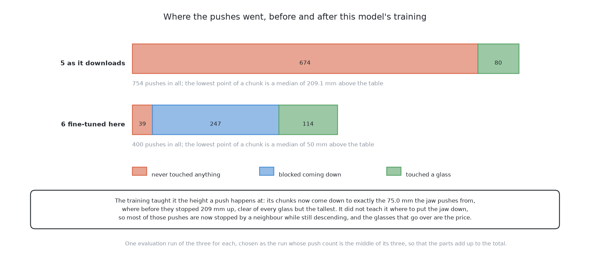

# The same model, fine-tuned here

This page describes the sixth of the six solutions in about eight minutes of
reading. It is the same library, the same model and the same downloaded weights
as [a foundation model as it
downloads](06_a-foundation-model-as-it-downloads.md), with one thing added: a
small correction learned from pushes made on the examiner's tables. The pair is the
cleanest comparison in the book, and the answer it gave was not the one the book
expected. By the end of this page you will know what low-rank adaptation is,
what the training cost, what it scored, and why a solution that acts badly can
score worse than one that barely acts at all. The full treatment is in [the
chapter on this
solution](../09_the-same-model-fine-tuned-here/01_what-it-is.md), which is the
longest in the book at about seventy minutes.

## Contents

1. [What it is](#1-what-it-is)
2. [How it works](#2-how-it-works)
3. [What it needs](#3-what-it-needs)
4. [What it scored](#4-what-it-scored)
5. [Where it is strong and where it breaks](#5-where-it-is-strong-and-where-it-breaks)
6. [When to choose it](#6-when-to-choose-it)

## 1. What it is

**Fine-tuning** means keeping a model's existing weights and continuing their
training on your own, much smaller, collection of examples, so that the general
competence it arrived with is kept while its behaviour moves towards the job in
front of it. It is the standard repair for a domain gap, and the domain gap in
this pair is severe: the borrowed model learned from real cameras in cluttered
rooms, and it is shown flat shapes on an empty rectangle.

This solution applies that repair using **low-rank adaptation**. Rather than moving all
450 million of the model's numbers, it learns a small correction — about four million
numbers — and adds it to them. Only the correction carries gradients and optimiser
state. So what has to be held in memory is the model plus a little, and afterwards the
correction folds into the weights so that running the result costs exactly what running
the original cost.

The demonstrations come from [geometry generates, a model
ranks](03_geometry-generates-a-model-ranks.md), the same teacher [imitation from
demonstrations](04_imitation-from-demonstrations.md) learns from. That makes
this solution part of two clean pairs at once: against the borrowed model it
measures what fine-tuning buys, and against the solution fitted here from random
numbers it measures what the borrowed weights were worth.

## 2. How it works

**The teacher records the demonstrations.** The ranked geometric solution runs
over the training half of the tables, unattended, and its pushes are recorded. A
filter discards the recordings in which something went wrong. Nobody holds a
controller at any point.

**The correction is fitted.** The borrowed weights stay as they are and the
low-rank correction is trained to reproduce the teacher's actions, so the chunks
the model emits come out in this cell's own range rather than in whatever range
the borrowed recordings happened to use.

**At run time the chain is the borrowed model's chain.** The view from the top,
one instruction in plain English and the arm's own pose go in. The corrected
model returns an **action chunk**, a short run of consecutive jaw waypoints
predicted together in one pass. The shared geometry refuses the glasses that tip
before they slide, and a chunk whose path would reach one of those is not
carried out. The examiner then follows the waypoints directly, the arm looks again,
and the loop repeats.

Three things this solution does **not** do are worth naming, because it is easy
to credit the model with them: it does not refuse, it does not choose
destinations, it does not own the loop, and it does not stop a push that is
going wrong. Each of those belongs to the shared machinery around it.

What fine-tuning closes is the gap between the inputs. What it cannot touch is the shape
of the model — a large fraction of those 450 million numbers serve a language channel
this task does not use. Or the fact that nothing in behaviour cloning ever evaluates an
outcome, so the teacher remains the ceiling.

## 3. What it needs

It needs **LeRobot** and the **SmolVLA weights**. And the terms to read are the ones on
the weights rather than the ones on the library, because training a file further does
not relicense what it carried. It needs **its teacher built**, because the teacher's
pushes are the training set, and simulator time to record them.

**It did not need a rented accelerator, and that is where the plan was wrong.**
The training ran on this machine and held about a gigabyte, which low-rank
adaptation is exactly why. What renting would have bought is time rather than
memory, and time is what this solution is short of: it ran about one part in
three hundred of the library's own recipe for this model, so **every number it
reports carries that caveat**. [What it
needs](../09_the-same-model-fine-tuned-here/05_what-it-needs.md) gives the
licence terms, the memory figure and the arithmetic behind that fraction.

## 4. What it scored

All six solutions are given the same 50 tables holding 251 glasses, of which 203
have no room at the start. Its partner's row is shown beside it, because the
pair is the point. Both are run several times and the figure shown is the middle
one.

| | tables done | tables wrong | glasses racked | toppled | pushes |
|---|---|---|---|---|---|
| this solution, fine-tuned | 1 | 36 | 56 | 40 | 369 |
| the same model, as it downloads | 1 | 9 | 48 | 12 | 620 |

**The training worked and the score got worse.** Both halves of that sentence
are true, and reading only one of them misreads the pair.

The training worked in the sense that matters, and the measurement is exact. The
borrowed model's chunks stop a median of 217 mm above the table; the fine-tuned model's
come down to a median of 75 mm. This is precisely the height the jaw has to ride at to
move anything. It racks 56 glasses against 48 in a little over half the pushes, and both
finish about one table in fifty.

The score got worse because it learned the height a push happens at without
learning where to put the jaw down.

In the middle run, 223 of its 369 pushes are blocked on the way down, where its
partner has none blocked at all, and it topples 40 glasses where the geometry
topples one. Its partner stays out of the "wrong" column largely by never
reaching a glass: it hovers, achieves little, and is usually marked correct but
incomplete.

So the gap between the two does not measure training buying nothing. It measures
**training buying enough competence to act and not enough to act safely**, on a
scorecard where a toppled glass cannot be undone. **A policy that does nothing
scores better than a policy that does the wrong thing**, and any reading of this
pair that skips that sentence has misread it. The conclusion about the method is
still open, and [how it
compares](../09_the-same-model-fine-tuned-here/06_how-it-compares.md) shows
where the pushes went in both runs and says what would move it. The full table
for all six is in [the results](../10_the-results.md).

## 5. Where it is strong and where it breaks

It is fitted on the inputs it will be shown, which is the single strongest
thing about it and the thing its partner cannot claim. Its demonstrations cost
nothing, because the teacher is a program. Its training is affordable and its
run-time cost is its partner's, because the correction folds into the weights.

It also needs no reward function, which is a larger advantage than it sounds. A
reward is a score, and a score written as a fine turns "never topple a glass"
into a price, and a price is a trade the policy may decide to make. Learning
from examples of correct pushes leaves "never topple" as a constraint rather
than a price.

Against that, four kinds of weakness, each argued in [how it
compares](../09_the-same-model-fine-tuned-here/06_how-it-compares.md). It
inherits the borrowed model's faults: a language channel this task does not use,
a chunk it commits to whatever happens inside it, and no account of why it did
anything. It inherits its teacher's ceiling, because nothing ever showed it a
better push than the ranked geometry, and it never saw a refusal, so it proposes
pushes on glasses that must not be pushed. It owes part of its gain to this
examiner's own friction, now sitting in its weights as a memorised constant that
no real table would honour. And it does not do the things listed in section 2 at
all.

## 6. When to choose it

Choose fine-tuning a foundation policy when a borrowed model nearly works, the
demonstrations are cheap, and **something outside the policy can stop it doing damage**.
That last condition is the one this solution shows the cost of ignoring. The topple
refusal in front of it checks whether a *glass* may be pushed. Nothing checks whether
the *chunk the model produced* is safe to carry out, and 46 toppled glasses a run is
what that gap is worth.

Do not choose it on this much compute. One part in three hundred of the
recommended training is not a fair test of the method, and the fair conclusion
from this row is about the amount of training rather than about fine-tuning.

Do not choose it, either, where demonstrations from a working teacher are the
only data available and the student will reach states the teacher never does.
That is the structural flaw here, and the repair is to collect corrections in
the states the student actually visits, not to collect more of the same
demonstrations.

If you read this page for one reason, read it for the pair with its partner.
Same library, same model, same weights, same examiner, same input, same output
and the same marking, and the only difference is the training. One forward pass
costs the same for both, 285 ms against 292, but this solution needs about 1.4
passes a push where its partner needs 1.0, because 421 of its 1,515 answers aim
at a glass the loop has already refused and are thrown away. **Fine-tuning
changed what the model answers, not what it costs to ask.** And read the result
carefully, because the obvious reading of it is wrong.

The code is in
[`src/09_pushing-the-glasses-apart/06-smolvla-fine-tuned/`](../../../code/src/09_pushing-the-glasses-apart/06-smolvla-fine-tuned)
and it writes its own `results.json` beside itself. The full treatment, with low-rank
adaptation explained, where the demonstrations come from, the two ways training on one
cell's pushes goes wrong. And a second way on a markedly larger model, starts at [what
it is](../09_the-same-model-fine-tuned-here/01_what-it-is.md).

← [A foundation model as it downloads](06_a-foundation-model-as-it-downloads.md) · [One fixed nudge — what it is](../04_one-fixed-nudge/01_what-it-is.md) →
