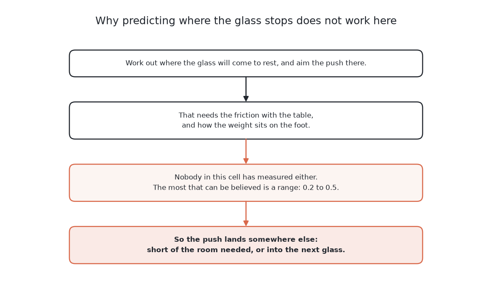
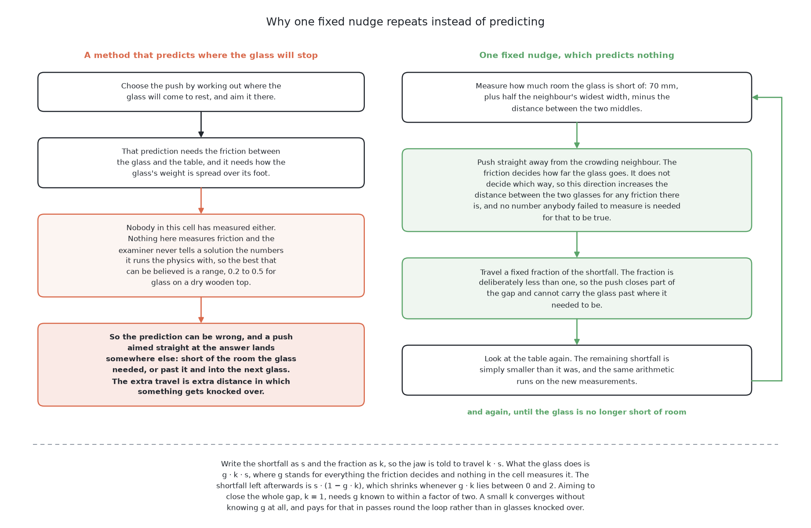

# What it is

> **What it uses.** It uses NumPy for a little arithmetic on positions and
> widths, and nothing else. The cell moves the jaw, not this solution. On the
> examiner's tables the physics engine moves it, and in the real cell MoveIt
> does. There is no model, no weights file and no training set. Not one number
> here was fitted to data.
> **What it does.** It finds a glass that has no room for the gripper. It finds
> the neighbour that crowds it most. It pushes the glass straight away from that
> neighbour. The push is a fixed share of the missing room, made as low as the
> gripper can reach. Then it looks at the table again and repeats. It never predicts where
> the glass will stop. It stops when every glass has room, when the push budget
> is used up, or when the only safe answer is to refuse.
> **How the output is produced.** For each glass, it works out how much room is
> missing, measured to each neighbour's edge. It takes the glass with the most
> missing room, and the neighbour that causes it. It checks that glass against
> the tipping rule, and refuses it if the check fails. It points the jaw along
> the line from the neighbour's middle through the glass's middle. It sets the
> push length to a fixed share of the missing room. It hands this over as one
> push, and the examiner turns it into jaw movements. Then it looks again.
> **What it costs.** It costs nothing you have to buy: no data, no training and
> no rented hardware. Its only cost is arm time, which
> [what it needs](05_what-it-needs.md) explains.

> **The cell is described once, in [the cell](../../08_seeing-the-glasses/01_the-cell.md).**
> That page covers the layout, the two camera positions, the four sensors and
> the words this project uses. This page covers only what is special to this
> solution.

## Contents

1. [Introduction](#1-introduction)
2. [A film of one table](#2-a-film-of-one-table)
3. [The problem this solves](#3-the-problem-this-solves)
4. [The main idea](#4-the-main-idea)

## 1. Introduction

This page describes the simplest way to move a crowded glass away from its
neighbour. It is for a reader who wants to see the baseline before the six
solutions that try to beat it. The method is one subtraction, one
multiplication and a loop. It measures how much room a glass is missing. It
pushes the glass a fixed share of that amount, straight away from the glass
that crowds it. Then it looks again. Nothing in it is fitted, searched for or
predicted.

This solution is **the control**. A control is the plain method that every
other method is measured against. Five of the other six solutions pay for data,
training and hardware. The sixth uses a large model that someone else trained.
You can only judge those costs against a method that costs nothing. So every
other solution must beat a fixed nudge. If it cannot, it has earned nothing.

This solution also has one safe property. It always pushes a glass away from
its neighbour, so the push can never carry the glass back into that neighbour.
A push that is too long or too short can still only add space between the two.

By the end of this chapter you will know four things. You will know what the
missing room is, and why it is measured to the neighbour's edge. You will know
what a closed loop is. You will know why pushing part of the gap works better
than pushing all of it. And you will know why this solution cannot teach any
other solution.

Two notes come first, because they change how you read the rest.

**Part of this solution is built and part of it is a design.**
[What is built and what is a design](03_how-it-works.md#5-what-is-built-and-what-is-a-design)
separates the two. The examiner, the room test, the tipping rule and the loop
exist in this repository and have been run. The rule for choosing a direction
and a distance is a design that would fit inside them.

**No glass's size is written below.** The cell's rule is that glass sizes are
never written down. So this page compares glasses to each other, for example
"wider than its neighbour". It gives numbers only for the gripper, the cell or
a results file. The pictures may show the *range* a kind of glass is drawn
from. That range is a rule, not a measurement of a real glass.

The next two pictures show why the loop has this shape. The first shows the
method this solution rejects, which is aiming the push at where the glass will
stop. The second shows what this solution does instead.

So this solution makes no prediction. It measures, pushes a little way in a
direction that is right for any friction, and looks at the table again.

## 2. A film of one table

The introduction described the method in words. This film shows it working on
one table in the simulator, at one and a half times real speed.

[One fixed nudge on one table, 13 seconds and no sound](https://docs.dodao.io/videos/pushing-the-glasses-apart/01-one-fixed-nudge.mp4 "video")

The table holds six glasses, where the average is five. Five of them have no
room at the start.

The arm racks the one glass that already had room. It makes two pushes. Then it
refuses the other five, each for its own reason. Two tip before they slide. Two
tipped when the push was tried. One has nowhere clear to be pushed to. Nothing
is knocked over, and the table is left unfinished. This is the most common
result for this solution: one or two glasses taken, the rest refused, none
broken.

Notice how short the film is. The method is built to push a little and look
again. But here it rarely gets the chance. The hand is too wide to stand beside
most of these glasses. It is also too high to push them without tipping them.
So the loop runs out of safe pushes long before it runs out of budget.

The six solutions measured so far are filmed on this same table.
[The six films](../11_the-results.md#3-the-six-films-all-of-the-same-table)
collects them and says how the table was chosen.

The film shows what the method does. The next section says what problem such a
plain method is there to solve.

## 3. The problem this solves

The film showed the method at work, and this section says why the book needs
it. The arm knows where each glass stands, how tall it is, and how wide it is
at its widest and at its foot. Each reading has some measurement error. Some
glasses stand so close together that the open jaw cannot get round one without
hitting the next. So the arm has to slide them apart before it can lift them.
[What is asked for](../01_the-problem/01_what-is-asked-for.md) sets out this
task in full.

One number makes this hard. That number is the friction between the glass and
the table. No solution is told it, and nothing in the cell measures it.
[What a solution is never told](../01_the-problem/02_what-goes-in-and-what-comes-out.md#4-what-a-solution-is-never-told)
explains this. Because of it, nobody knows in advance how far a push will move
a glass.

A solution can deal with this in two ways. It can try to fill the gap, for
example by learning what a push does. Or it can make no prediction at all, and
correct itself by measuring again. This solution takes the second way, as far
as it goes. It predicts nothing and assumes nothing about friction.

The next section states the one claim this solution does make, and why that
claim needs no friction.

## 4. The main idea

The last section said this solution predicts nothing. This section gives the
one claim it does make. **Pushing a glass away from a neighbour always
increases the distance between them, whatever the friction is.** The friction
decides how far the glass goes. It does not decide which way. So the method is
sure about direction and careful about distance. It fixes the distance by
repeating, not by knowing.

From that claim, the method makes four decisions. Each one is a single line of
arithmetic on numbers the arm already has.

1. **Which glass to push.** It pushes the glass that is missing the most room.
   [The shortfall](03_how-it-works.md#2-the-shortfall-and-why-it-is-measured-to-the-neighbours-edge)
   defines this amount exactly.
2. **Which way to push it.** It pushes straight away from the neighbour whose
   edge comes furthest into that glass's room. The direction is the line from
   the neighbour's middle through the glass's middle.
3. **How far to push it.** It pushes a fixed share of the missing room. The
   share is less than one, so each push closes part of the gap. The next pass
   closes more.
4. **How high to touch it.** It always touches as low as the gripper can reach.
   A lower touch is always further from tipping. The only question is whether
   even the lowest touch is low enough.
   [When a glass cannot be pushed safely](04_a-worked-example.md#1-when-a-glass-cannot-be-pushed-safely)
   answers that.

Then the arm looks at the table again, and makes the four decisions again from
the new measurements. It remembers nothing between passes except how many
pushes it has used.

The word **fixed** in the name does not mean a fixed number of millimetres. On a
crowded table, one glass may miss almost no room and another may miss several
tens of millimetres. One distance cannot suit both. What is fixed is the
**share**. It is one constant, the same for every glass on every table. It is
chosen once by argument and never changed. It is the only free number in the
whole method.

← [The seven solutions — questions and answers](../03_the-seven-solutions/09_questions-and-answers.md) · [The code](02_the-code.md) →
