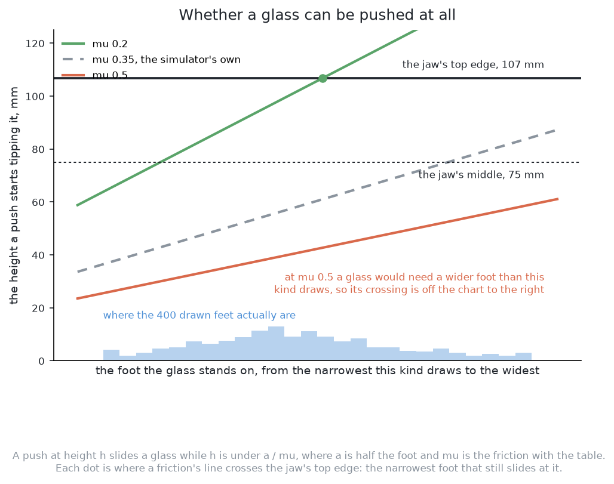
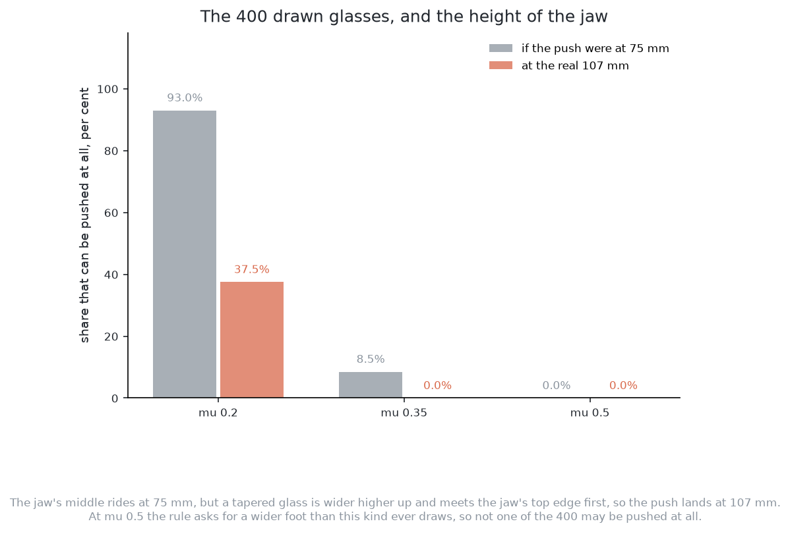

# A worked example

This page follows this solution through two tables. It clears the first one and
fails on the second. It starts with the case this book keeps coming back to: a
glass that cannot be pushed safely at all. An example that shows only the easy
case would teach the wrong lesson.

## Contents

1. [When a glass cannot be pushed safely](#1-when-a-glass-cannot-be-pushed-safely)
2. [A worked example](#2-a-worked-example)

## 1. When a glass cannot be pushed safely

Before the method can push a glass, it must know the push is safe. A glass
slides when the jaw touches it low, and tips when the jaw touches it high.
[Pushing without toppling](../01_the-problem/05_pushing-without-toppling.md#3-the-limit-slide-or-tip)
sets out this rule once. It also explains why the height that counts is the
jaw's top edge, at 107 mm, and not the 75 mm the arm aims at. This section
shows only what the rule means for this solution.

The first picture draws the rule. The safe height rises with a wider foot, and
falls with higher friction. So there is one line for each friction. The jaw's
two heights are drawn across them. A glass can be pushed when its line is above
the height where the jaw touches it.

The second picture shows what the 32 mm between those two heights costs. It
takes 400 glasses of one kind. At each of three frictions, it shows what share
could be pushed at all. At the simulator's own friction, the share falls from 9
in every 100 to none. At the highest friction, no glass of this kind can be
pushed from either height.

The arm is never told the real friction. So the three lines are three possible
answers for the same glass. The solution must stay safe without knowing which
one is true.

**This solution has a second reason to refuse, and it costs the most.** It can
only push from the neighbour's side, and the long tool often has nowhere to
stand there.
[Where it is strong and where it breaks](06_how-it-compares.md#1-where-it-is-strong-and-where-it-breaks)
explains this.

With both reasons to refuse in view, the next section follows the method
through two whole tables.

## 2. A worked example

The last section showed when the method must refuse. This section shows the
whole loop on two tables. On the first, the method is enough. On the second, it
is not. Both tables describe glasses by comparing them, as the project's rule
requires. Both hold glasses of the tapered kind. This kind stands on the
narrowest foot for its width, so the tipping rule is hardest on it.

### A table where it works

Three glasses stand in the glass zone. Call them A, B and C. The table below
gives each one's place, and its size compared with others of its kind. That is
all the method ever reads about a glass.

| | where it stands | as this kind goes |
| --- | --- | --- |
| A | the middle of the zone | narrow, standing on a broad foot |
| B | close beside A, further from the arm | the widest the kind allows, on a broad foot |
| C | the far corner of the zone, clear of both | middling |

**The room test.** A needs 76 mm plus half of B's width. B is very wide, so B's
rim reaches into A's ring, and A is short of room. Now turn it round. B needs
76 mm plus half of A's width. A is narrow, so B has room at the same distance.
C is clear of both. **So only A is on the list.** One gap gives two different
answers, and the narrow glass is the one with the problem.

**Can A be pushed?** A's foot is broad for its kind, but still not broad enough
to settle the question. At the high end of the friction range, A would tip. So
the answer is **try**. The arm pushes A 5 mm, and looks before and after. Say
A clearly moved. Then it slid, A is proven, and the real push follows. In the
measured runs a clear move like this is rare, and
[the code](02_the-code.md#1-the-code-at-the-heart-of-it) says why. The test
push counts against the four pushes allowed at one glass, so three are left.

**The push.** The blocking neighbour is B. So the direction is the line from
B's middle through A's middle. The push length is the gain times A's
shortfall, so it is only part of what A needs. The fingertips come down on that
line, just outside A's widest part, and feel forward until they touch. The
push is made. The jaw backs off and lifts.

**Look again.** A moved most of the way, so its shortfall is smaller but not
zero. Nothing else changed, because A moved away from B, and C was never near.
The second pass does the same sum on the smaller shortfall, so its push is
shorter. The third pass finds A's shortfall at zero or below, and stops
pushing. Then A, B and C are all racked.

**What that cost.** It cost one test push, two real pushes, and a look after
each one. A method that knew the right distance would have used one push. Each
push was shorter than the one before. Nothing was knocked over, nothing left
the glass zone, and no claim about friction was made.

### A table where it does not

Four glasses are read the same way. This time one of them is crowded from two
sides.

| | where it stands | as this kind goes |
| --- | --- | --- |
| A | the middle of the zone | middling, on a broad foot |
| B | close beside A, further from the arm | wide |
| C | close beside A on the opposite side, nearer the arm | wide |
| D | a corner of the zone, clear of everything | narrow, on the narrowest foot the kind allows |

**A is short of room against both B and C.** The blocking neighbour is
whichever reaches further into A's ring. Say it is B. The method pushes A
straight away from B. But C is on the other side, so that push moves A towards
C. A's shortfall against B gets smaller, and its shortfall against C grows by
about the same amount. The next look finds C is now the worst. So the method
pushes A away from C, and undoes the first push. **The method goes back and
forth between two directions and uses up its budget.** No gain fixes this,
because the problem is the direction, not the distance. When the budget runs
out, the glasses left are reported with a reason. The table then scores as
correct but incomplete, not wrong.

This is a failure of the method's design. A push that moved A sideways, out of
the gap between B and C, would free A in one go. Such a push exists on this
table. The measurements already hold what is needed to find it. But finding it
needs a search over directions, and this method gave that up to stay simple.

**The same table can also fail for a different reason.** If B and C stand very
close to A, the tool has nowhere to stand on either side. Then the method
refuses A before it pushes at all.
[Where it is strong and where it breaks](06_how-it-compares.md#1-where-it-is-strong-and-where-it-breaks)
explains this failure.

**D shows a refusal that is nobody's fault.** D is clear of every glass, so it
is simply racked. But if D had been crowded, it would have been refused. It
stands on the narrowest foot its kind allows, so it tips before it slides at
any friction the cell might have. No method in the set can push D. The only
correct answer is to refuse it with the reason.

← [How it works](03_how-it-works.md) · [What it needs](05_what-it-needs.md) →
