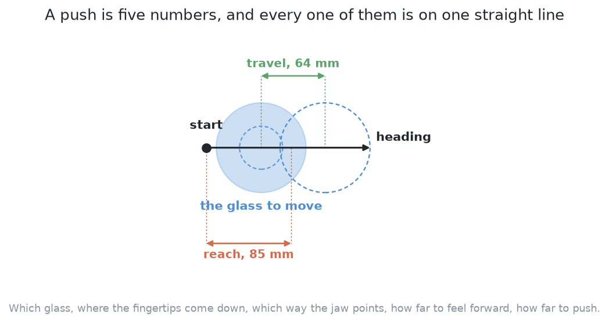

# The code

This page shows the main code of this solution. It also says what the solution
hands to the rest of the cell. [How it works](03_how-it-works.md) then explains
each part of this code.

## Contents

1. [The code at the heart of it](#1-the-code-at-the-heart-of-it)
2. [The pushes are what this contributes](#2-the-pushes-are-what-this-contributes)
3. [How the concepts fit together](#3-how-the-concepts-fit-together)

## 1. The code at the heart of it

This solution adds two small things to [solution
1](../04_one-fixed-nudge/01_what-it-is.md). The first is the model: boosted
trees from scikit-learn. They are fitted once, and then they give one score to
each candidate push. The second is the label, which is the number the trees
learn to predict. The label is measured by making the push in the simulator and
looking at the table afterwards. The candidate pushes come from solution 1's
code, unchanged. So only the choice is new.

The model code is in
`src/09_pushing-the-glasses-apart/02-geometry-ranked/ranker.py`. It has four
steps, and the code marks them with the same numbers. Steps 1 and 2 run once,
before the arm moves. Steps 3 and 4 run once for each push.

1. Set up the trees. This fixes how many trees there are, how deep each one is,
   and how small a correction each one may add.
2. Fit the trees to the training table. The table has one row of numbers for
   each candidate and one measured result for each row.
3. Ask the geometry for every safe push on the table, and for the reason any
   glass was refused. If there is no safe push, stop, because there is nothing
   to order.
4. Turn each safe push into its eight numbers and ask the model for a score.
   Sort the pushes by score, highest first. The sort is stable, which means
   that pushes with equal scores keep the order the geometry gave them.

```python
from sklearn.ensemble import GradientBoostingRegressor
...
TREES = 200
DEPTH = 3
LEARNING_RATE = 0.05
...
    @classmethod
    def fit(cls, rows: np.ndarray, labels: np.ndarray, seed: int = 0) -> Ranker:
        # Step 1: set up the trees, untrained -- how many, how deep, how small a step each one takes
        trees = GradientBoostingRegressor(
            n_estimators=TREES, max_depth=DEPTH, learning_rate=LEARNING_RATE, random_state=seed
        )
        # Step 2: fit them to one row of numbers per candidate and the room that candidate gained
        trees.fit(rows, labels)
        # Step 2: hand back the fitted model -- from here it answers with one score per candidate
        return cls(trees)
...
def ranked(
    seen: list[Seen], skip: set[int], score: Scorer
) -> tuple[list[Candidate], np.ndarray, dict[int, str]]:
    """Every safe push on the table, best first, with its score and the refusals.
    ...
    """
    # Step 3: ask the geometry for every safe push on the table, and why a refused glass has none
    kept, why = survivors(seen, skip)
    # Step 3: stop here if the geometry allowed nothing -- there is nothing for the model to order
    if not kept:
        return [], np.zeros(0), why
    # Step 4: describe each surviving push as its eight numbers and ask the model to score it
    scores = np.asarray(score(features.rows(seen, kept)), dtype=np.float64)
    # Step 4: sort by score, highest first; a stable sort leaves tied candidates in their old order
    order = np.argsort(-scores, kind="stable")
    # Step 4: hand back the pushes best first, their scores in the same order, and the refusals
    return [kept[i] for i in order], scores[order], why
```

The label is the most important design choice. It is made in
`src/09_pushing-the-glasses-apart/02-geometry-ranked/rollout.py`, which tries
one candidate push and measures what it did. Its steps are numbered from one
again, because it is a separate file. It runs before any of the steps above.

1. Put the table back exactly as it was, so every candidate starts from the
   same table. Then make the push, and keep what the jaw felt.
2. Look at the table again with the camera. Measure the room gained: the
   table's lack of room before the push, minus its lack of room after.
3. Check whether any glass now leans more than a standing glass can. A topple
   gets a worse label than any push. Any other push gets the room it gained.

```python
def roll(table: Bench, before: Before, candidate: Candidate) -> Rolled:
    """Put the table back as it was, make the push, and measure what it did."""
    # Step 1: put the table back exactly as it was -- every candidate is judged from the same start
    restore(table, before)
    # Step 1: make the push for real, and keep what the jaw felt while it was pushing
    felt = table.push(candidate.push)
    # Step 2: look at the table again with the camera, exactly as the arm would during a run
    after = table.look()
    # Step 2: measure the room gained: the table's shortfall of room before, less its shortfall now
    gained = nudge.shortfall(before.layout) - nudge.shortfall(truth(table))
    # Step 3: ask whether any glass is now leaning further than a standing glass ever leans
    fell = any(table.tilt(i) >= STANDING_TILT_DEG for i in table.on_table())
    return Rolled(
        # Step 3: a topple scores worse than any push can be good; anything else scores room gained
        label=TOPPLED if fell else gained,
        ...
    )
```

Two things show in these blocks. First, `survivors` runs before the model, and
`score` only reorders what it returns. This is why the model is safe, as [what
it is](01_what-it-is.md#1-introduction) explains. Second, the label is `gained`,
which is the room the whole table gained. But the run is scored on how many
glasses can be gripped. These two are not the same, and [how it
compares](06_how-it-compares.md#1-where-it-is-strong-and-where-it-breaks)
shows what that difference costs.

The code shows how a push is chosen. The next section says what the chosen push
looks like when it leaves this solution.

## 2. The pushes are what this contributes

The previous section ended with a chosen push. This section says what form that
push takes.

This solution outputs a **parameterised push**. That is a push described by a
few numbers: which glass, where the fingertips come down, which way the jaw
points, how far to feel forward, and how far to push. The examiner's `push()`
takes exactly these numbers. The examiner's own code turns them into a jaw
movement, the same way for every solution. [What goes in and what comes
out](../01_the-problem/02_what-goes-in-and-what-comes-out.md) describes that
step.



So **this solution adds only the choice of push**. The movement belongs to the
examiner, and the physics belongs to MuJoCo. The score looks at the table
afterwards, not at the action, as [the
examiner](../01_the-problem/03_the-examiner.md#4-the-score-is-the-outcome-not-the-action)
explains.

This has a real limit. A parameterised push is a straight push along one line.
A policy that outputs waypoints can make a push that curves, slows down or
turns. This solution cannot make any of those pushes.

The push is now defined. The next section joins all the parts into one loop.

## 3. How the concepts fit together

The two sections above showed the parts. This section puts them in the order
they run. The loop is the one in [pushing without
toppling](../01_the-problem/05_pushing-without-toppling.md#5-the-loop-plan-feel-look-again):
plan, feel, look again.

Before any run, the model is fitted once. Pushes are listed on the training
tables. Each one is made in the simulator and labelled with the room gained and
whether a glass toppled. Then the trees are fitted to those labels.

During a run, one pass of the loop goes like this.

1. `look()` gives the place and widths of each glass.
2. Any glass that already has room is racked.
3. For each crowded glass, the tipping test runs. A glass that would tip is
   refused, with its reason.
4. For the other glasses, the geometry lists the safe pushes.
5. The model scores each push, and the pushes are sorted.
6. The best push goes to the examiner, which makes it and reports what the jaw
   felt.
7. The arm looks again, and the loop starts over from the table as it is now.

The loop reads the table again after every push. So a push that went too far or
too short is not a disaster. The next pass simply plans from where the glass
really is. This is why a bad order costs one push and not a whole run.

The loop cannot fix a toppled glass, because nothing here lifts a glass. That
is why tipping is a refusal and not a risk to weigh. The next page, [how it
works](03_how-it-works.md), explains each part of this loop in detail.

← [What it is](01_what-it-is.md) · [How it works](03_how-it-works.md) →
