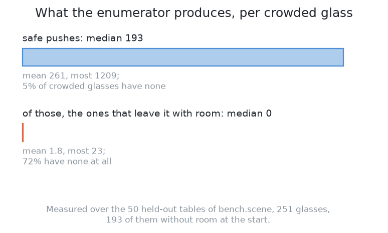
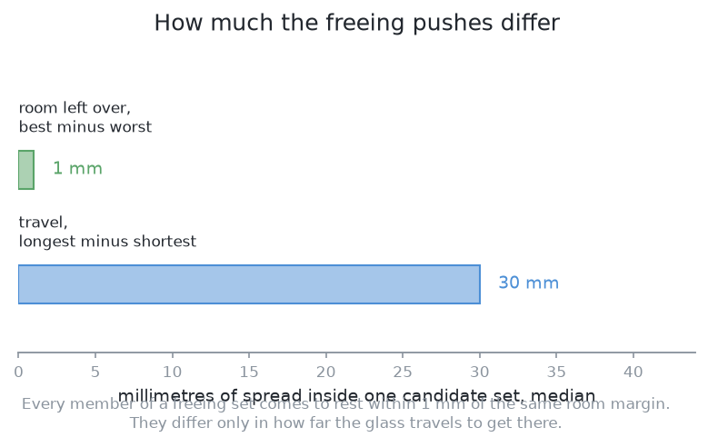
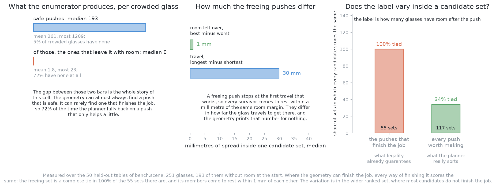

# How it works

This page explains each part of this solution, in the order the parts run. It
follows [the code](02_the-code.md) and explains what that code does.

## Contents

1. [What the geometry proposes](#1-what-the-geometry-proposes)
2. [What the filter removes before the model is asked](#2-what-the-filter-removes-before-the-model-is-asked)
3. [The model: boosted trees that score one candidate at a time](#3-the-model-boosted-trees-that-score-one-candidate-at-a-time)
4. [The inputs are lengths, counts and ratios](#4-the-inputs-are-lengths-counts-and-ratios)
5. [How it is trained](#5-how-it-is-trained)
6. [Where the learned part sits is what makes it safe](#6-where-the-learned-part-sits-is-what-makes-it-safe)
7. [It is the teacher](#7-it-is-the-teacher)

## 1. What the geometry proposes

The geometry comes first, because it decides which pushes the model will see.
The part of the code that lists the pushes is called the enumerator.

For one crowded glass, the enumerator tries **72 headings**, one every 5°, all
the way round. A heading is a direction of push. Along each heading it tries
longer and longer pushes, in **2 mm steps up to 150 mm**. At each step it asks
four questions.

- Does the path of the moving glass miss every other glass?
- Does the path of the fingers miss them?
- Does the path of the wrist and the gripper body miss them?
- Is the end point inside the glass zone and easy for the arm to reach?

If any answer is no, the heading stops there. A clash at one length is still
there at every longer length on the same line.

Two facts about this loop decide everything after it.

**Each heading stops at the first push that gives the glass room.** So each
heading gives at most one push that finishes the job. One glass can have at
most 72 of these. Each one is the shortest push that works along its line.

**Pushes that do not finish the job are kept too.** A push that leaves the
glass still crowded is kept if it cuts the table's total lack of room by at
least 10 mm. The printed rule uses these pushes only when no push on the table
finishes the job. This set is large, because it holds every 2 mm step up to the
first clash. `spread.json` gives the counts. Over 269 crowded glasses on the
training tables, the middle glass gets 84 candidates. Over 101 whole-table
decisions, the middle decision gets 261.

The first fact is the most important point on this page. Each heading stops as
soon as the push works. So **every push that finishes the job ends on the same
line**: just past the point where the glass has enough room, plus a 10 mm margin
for aiming error. They reach the same result from different directions. The run
is scored on how many glasses have room. On that score, these pushes are a
**tie**. They differ only in how far the glass travels, and the geometry already
knows that distance.

**When every choice in a group is tied, ranking the group tells you nothing.** A
model would give each push the same value. That answer is correct, but it is no
help. So a ranker can only learn something from the pushes that ease the
crowding without finishing the job. Those pushes really do differ from each
other.

Three measurements over fifty held-out tables show how far this goes. The three
pictures below show them one at a time.

The first picture counts the pushes the enumerator finds for each crowded
glass. The geometry can almost always find a safe push. It can rarely find one
that finishes the job. So 72 per cent of the time, the planner uses a push that
only helps a little.

The second picture asks how much the pushes that finish the job differ. They all
leave the glass within one millimetre of the same room. They differ only in how
far the glass travels.

The third picture asks whether the label changes inside a group at all. In the
groups that finish the job, it never does. In the wider groups, it sometimes
does. That is the only place a ranker could learn anything.

So, before the model is even described, the arithmetic has already answered
most of its question. The next section looks at the one test that removes
pushes for safety.

## 2. What the filter removes before the model is asked

The previous section listed the pushes. One test on that list needs its own
section, because it guards against the one failure that cannot be repaired: a
toppled glass.

A glass slides if the jaw touches it low enough, and tips if the jaw touches it
too high. [Pushing without
toppling](../01_the-problem/05_pushing-without-toppling.md#3-the-limit-slide-or-tip)
explains the rule in full, with the heights of the jaw and the unknown friction.

What belongs to this solution is where the test runs. It runs inside the
filter, **before** the model. So a glass that would tip never reaches the
model, and no score can bring it back.

The next section turns from the filter to the model itself.

## 3. The model: boosted trees that score one candidate at a time

The filter leaves a list of safe pushes. The model must turn each push into one
number, and this section explains how.

**A decision tree** is a chain of yes-or-no questions. Each question looks at
one input, for example "is the push longer than 50 mm?". The answer sends the
push left or right. At the end, the push reaches a leaf, and the leaf holds a
number. That number is the tree's answer. One tree is a rough predictor,
because it can give only a few different answers.

**Boosting** turns many rough trees into one good model. It works like this.

1. Fit one small tree to the data.
2. Find what that tree got wrong for each push.
3. Fit the next tree to those errors, so it corrects the first tree.
4. Add the trees together, find what the sum still gets wrong, and fit another
   tree to that.
5. Repeat.

The sum of all the trees is the model. This solution uses two hundred trees,
each three questions deep. That is a normal size for its 4,844 rows of data.

This solution uses the **regression** form, which predicts a number. It also
scores **pointwise**. This means the model sees one push at a time and scores
it alone, without seeing the other pushes. The pushes are then sorted by score.
This is the simplest way to fit a ranking. [Learning to
rank](06_how-it-compares.md#learning-to-rank) describes the other two ways.

### Why trees rather than a network

The input is a short list of mixed quantities: an angle, some lengths, a count
and a ratio. Boosted trees were made for this kind of input. There are three
reasons.

First, a tree does not care about the scale of its inputs. An angle, a length
in millimetres and a count have very different ranges. A neural network adds
its inputs together with weights. So a network needs its inputs rescaled first,
or the large ones would swamp the small ones. A tree never adds its inputs. It
compares one input with one threshold, so rescaling changes nothing.

Second, a threshold fits this problem. Many questions about a good push are
comparisons with a limit. Is the end point clear enough for the gripper? Is the
push height below the tipping limit? Is the end point far enough from the edge
of the zone? A tree asks each of these as one question. A network needs more
data to learn a sharp limit.

Third, boosted trees report how much each input mattered. So a person can read
the list and find out why the model chose wrong.

**A network would also work.** On this input, a small network would need more
data and would explain less. But the input could be different. The model could
be given an **occupancy grid** instead, which is a picture of the zone with the
glasses marked on it. Then a network would be the right choice, because a
network reads a picture well and a tree does not. So the real choice is the
input: a short list of numbers, or a picture of the table. The model follows
from that choice. This solution uses the short list, for the reason the next
section gives.

## 4. The inputs are lengths, counts and ratios

The previous section chose a short list of numbers as the input. This section
says which numbers, and why **none of them is a position on the table**.

For each push, `features.py` gives the model these eight numbers, in this order.

- **The contact angle.** It is measured from the line between the glass and the
  nearest neighbour's edge. So "push straight away from the crowd" is always the
  same value, wherever the glass stands.
- **The push distance.** This is how far the glass travels after the jaw
  touches it.
- **The clear room at the end point.** This is the room the glass would have
  after the push.
- **The distance from the end point to the edge of the glass zone.**
- **The distance from the end point to the rack.**
- **How many neighbours stand within a set radius** of the glass. This is the
  one input that describes the crowd and not the push.
- **The foot width of the glass.** The tipping limit depends on it.
- **The push height divided by the tipping limit.** The limit here is for this
  glass's foot at the worst friction in the believed range. The jaw height is
  fixed, so this ratio changes only with the glass. It says how close the push
  is to tipping the glass.

Each input is a relation between two things, or a property of the glass, or a
comparison with a limit. None of them is "this push happens at x = 430,
y = −290".

**Leaving out the position is deliberate.** The examiner places crowded glasses
by a fixed rule, as [the examiner](../01_the-problem/03_the-examiner.md)
describes. Over many tables, crowds appear more often in some parts of the zone
than others. Give the model the position, and it will learn that pattern,
because the pattern is real in the training data. The model would then score a
push by where it is on this table. That is a fact about this examiner's rule,
not about pushing. If you move the rack or the zone, or place the tables by
another rule, the model describes a cell that no longer exists. Nothing would
show an error.

With relational inputs, this problem mostly goes away. Slide a whole group of
glasses across the zone, and six of the eight inputs stay the same. These six
are the contact angle, the push distance, the room at the end point, the
neighbour count, the foot width and the tipping ratio. A model given positions
would have to learn this from data, and it would learn it badly.

The other two inputs do change when the glasses slide, and they should. They
measure the distance to the edge of the zone and to the rack, and those did not
move. But they are still relations, not positions. An end point 15 mm from an
edge has 15 mm of margin wherever the edge is. A push with little margin really
is a worse push. The rule to remember is this: show the model the quantities
the physics depends on. The physics of a push depends on distances, angles and
widths, not on where the table's origin is.

The inputs are now fixed. The next section says how the labels for them are
collected.

## 5. How it is trained

The inputs come from the geometry. This section explains where the labels come
from, and why they cost nothing.

The training has four steps.

1. **List the candidate pushes on the training tables.** The examiner numbers
   its tables and keeps the ones above a dividing line for testing. So training
   uses only tables below that line. No solution is ever scored on a table it
   was trained on.
2. **Make every candidate push in the simulator.** Reset the table, make the
   push, and measure the result. On a real arm this would take far too long.
   Here it is cheap, because a push in MuJoCo is fast. The 4,844 pushes in the
   training set came from 190 training tables in minutes. This is why the data
   costs almost nothing.
3. **Label each push with what happened.** The label has two parts. The first
   is **how much clear room the whole table gained**. It is measured over the
   whole table, so a push that frees one glass by crowding another does not get
   full credit. The second is **whether a glass toppled**. A topple makes a push
   the worst possible candidate.
4. **Fit the model to those labels.** Only the order of the model's answers is
   used later.

Two points about the labels need more explanation.

**Some pushes in the training set toppled a glass, even though the filter
removes unsafe pushes.** This is not a contradiction. The filter uses a guessed
friction. When the guess is too high, the filter lets through a push it should
have refused, and the glass falls. 57 of the 4,844 rows are like this. These
rows are useful. They teach the model to prefer pushes that stay further from
the tipping limit. This is why the input "push height divided by the tipping
limit" is in the list. It lets the model be careful about a number nobody
measured.

**The labels are only as true as the examiner's friction.** The examiner uses
three fixed friction values, not measurements of real glass. So the model has
learned what topples in this simulator. Using it on a real table would rely on
a friction value that was never checked.

One more warning applies to retraining. **During a run, only the chosen push is
ever made.** So a log from a run has results only for pushes the model already
likes. Retraining on that log fixes whatever the model believed first. The
usual fix is to sometimes make the second-best push instead. Retraining should
also happen between runs, never during one. A model that changes during a run
makes the run impossible to repeat, and a run you cannot repeat is hard to
debug.

The model is now trained. The next section asks what happens when it is wrong.

## 6. Where the learned part sits is what makes it safe

The previous sections put a fitted model inside a machine that handles glass.
So the next question is what happens when the model is wrong. The answer is
that it can only waste a push, because the geometry settles every unsafe push
first. [What it is](01_what-it-is.md#1-introduction) explains this in full.

The same design is used for choosing camera positions in the camera book. But
there is one difference, and it raises the bar here. A wasted look only costs a
few seconds. **A wasted push costs a few seconds and a touch on a glass**, and
a touch is when things break. So a push ranker must be better than a camera
ranker to be worth as much.

Safety is the first reason this solution matters. The next section gives the
second reason.

## 7. It is the teacher

The previous section showed that this solution is safe. This section shows that
three other solutions cannot start without it. This is the biggest thing it
gives.

[Solution 3](../06_imitation-from-demonstrations/01_what-it-is.md) and [solution
6](../09_the-same-model-fine-tuned-here/01_what-it-is.md) both learn from
**demonstrations**. A demonstration is a recorded example of the task being
done. Here, one demonstration is one crowded table, from the first look to a
table where every glass has room, with each push recorded. Usually,
demonstrations are expensive, because a person must drive the arm by hand. That
is why imitation learning is often judged by how few demonstrations it needs.

**Here, demonstrations cost nothing.** This solution can run on as many training
tables as the examiner can make. Each run records a full demonstration with no
person present. The pushes in it are safe, because the same filter protects
them. Two hundred training tables gave 896 pushes in 52 seconds. So the only
cost is simulator time.

[Solution 7](../10_a-newer-larger-model-fine-tuned-here/01_what-it-is.md) learns
from the same pushes too. It reads solution 6's demonstrations as they stand.
The teacher's pushes are also used to test ideas about pushing itself. The
project's
[`measure_push_speed.py`](https://github.com/RobinNagpal/robot-arm-projects/blob/main/v5-pick-glasses/03-push-glasses-apart/02-geometry-ranked/measure_push_speed.py)
replays the push it chose at five speeds. A slower push did not topple fewer
glasses. [Pushing without toppling](../01_the-problem/05_pushing-without-toppling.md)
gives that result.

This is a real gift, but it has two costs. Both reach the solutions that learn
from it.

**The students inherit this solution's ceiling.** A policy trained on
demonstrations learns to copy them. Every demonstration here comes from the
enumerator. So the demonstrations hold only pushes that the enumerator can
list. Suppose the headings are too far apart to include the best push. Or
suppose a test wrongly rejects a good push. Then that push is in no
demonstration, and the student can never find it. So a student trained only on
this teacher cannot do better than this teacher. The usual fix is to let the
student act, score what happens, and learn from that too. But that is no longer
imitation learning, and it costs much more.

**Keeping only the successful demonstrations gives a biased sample.** It is
natural to keep the runs that finished the table and throw away the rest. But
the finished runs are not a fair sample of the tables. They are the tables this
solution is good at. The hard tables are the ones where the geometry runs out
of useful pushes. In this solution's own `results.json`, 43 of its 143 refused
glasses were still without room after pushing. Those hard tables are the ones
most likely to be thrown away. So a student trained only on successes learns
from easier tables than the ones it is tested on. It looks better in training
than in the test. There are two fixes. You can keep the failures with their
results. Or you can weight the kept runs so that hard tables count more. Doing
neither is the common mistake.

This page has explained each part. The next page, [a worked
example](04_a-worked-example.md), follows one table through all of them.

← [The code](02_the-code.md) · [A worked example](04_a-worked-example.md) →
