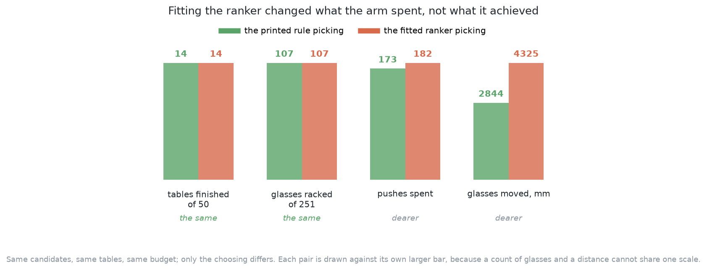
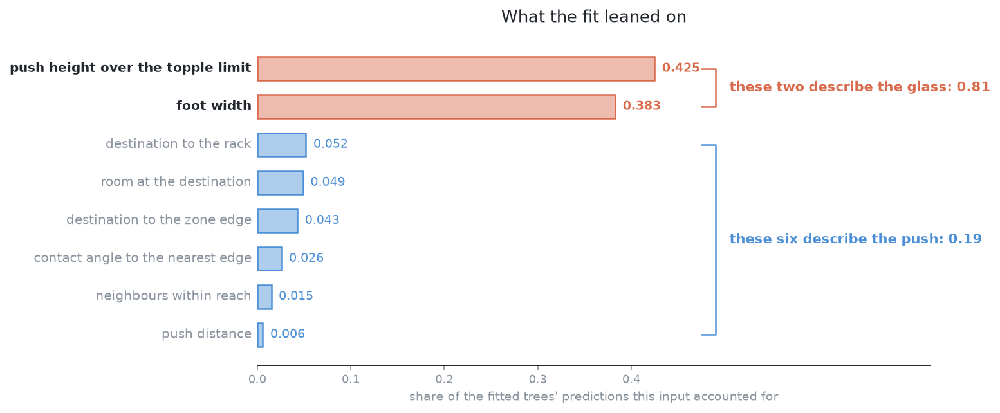

# How it compares

This page judges this solution. It says where the solution is strong and where
it breaks. It names the general ideas behind it. Then it places it beside the
other six solutions.

## Contents

1. [Where it is strong and where it breaks](#1-where-it-is-strong-and-where-it-breaks)
2. [The general ideas behind this](#2-the-general-ideas-behind-this)
3. [Where it sits among the others](#3-where-it-sits-among-the-others)

## 1. Where it is strong and where it breaks

The strengths come first. They are the reason to learn this design, even though
it did not pay off here.

**The model cannot cause a topple.** It only orders pushes the geometry already
found safe, as [what it is](01_what-it-is.md#1-introduction) explains. **It
falls back to something that works.** Delete the model, and the printed rule
runs the table. **It can be checked.** Every push can be printed with its score,
every refusal has a reason, and the model reports which inputs mattered. So a
person can find out why it chose wrong. **It is cheap.** It needs no
accelerator, no licence condition and no human labelling. It is also [the
teacher](03_how-it-works.md#7-it-is-the-teacher) for three other solutions.

Now the weaknesses, starting with the one that was measured.

**The pushes that finish the job are tied, and this was measured.** [What the
geometry proposes](03_how-it-works.md#1-what-the-geometry-proposes) explains
why they tie. `spread.py` checked it with 4,511 real pushes over 60 training
tables, and wrote `spread.json`. Within one glass's job-finishing pushes, the
room gained differs by **0.0 mm at the median**, over 161 groups. That is an
exact tie. The pushes that only ease the crowding differ by 11.9 mm. For one
glass, the printed rule already picks the best push in **159 of 206 groups**.

**So the fitted model did not beat the rule it was meant to improve.** Both ran
the same loop over the same fifty held-out tables. They had the same budget and
the same pushes to choose from. Only the chooser was different. The ranker
racked **107 of 251 glasses in 182 pushes** and finished 14 tables. The printed
rule racked **the same 107 in 173 pushes** and finished the same 14 tables.
Each toppled one glass. So the two agree on everything the run is scored on.
They differ only in how many pushes they used.

The reason is the label, not the trees. The model is fitted on **room gained**.
The run is scored on **glasses that can be gripped**. A push that spreads a
little room over three glasses gains more room than a push that frees one glass
fully. So the model prefers it. On the validation tables in `training.json`,
the ranker picks a job-finishing push in **47 of the 83 decisions that offer
one**. The rule picks one every time. By its own label, the ranker chooses
better: it loses 4.4 mm of room against the best push, and the rule loses
18.7 mm. But it still does not clear more tables.

The model's own report points the same way. The tipping ratio and the foot
width make up 0.425 and 0.383 of its decisions. The push distance comes last,
at 0.006. So the model mostly learned which glass is risky to push, not which
push is good. **The verdict is to keep the simpler rule.**

**What the design cannot do.** It cannot invent a push, so it is only as good as
the enumerator. It cannot make a push that is not a straight line. It does not
carry over to a different number of glasses. A model trained on tables of five
has never seen the crowding of eight, and nothing warns you. And it does
nothing about the glasses the geometry has run out of pushes for.

**What it cannot survive.** A log from a run holds results only for pushes the
model already likes. Retraining on it locks in early mistakes, unless the arm
sometimes tries the second-best push. If you change the headings, the zone or
the way tables are drawn, **the model then describes a cell that no longer
exists**. Nothing shows an error. And every label depends on the examiner's
friction values, which were never measured on real glass.

**When it fails, it fails without any sign.** A badly fitted ranker orders the
pushes almost at random. Nothing errors and nothing topples. The run just uses
more pushes than it needs. That is how it failed here. The failure was only
found because the test was run: the same tables, once with the model and once
without it.

The judgement is made. The next section names the general ideas behind this
solution, so you can use them elsewhere.

## 2. The general ideas behind this

The previous section judged this solution in this cell. Nothing in it was
invented for glasses. Four ideas in it are worth knowing on their own. For each
one, this section says where it is usually right and where it is not.

### Generate, veto, then rank

Arithmetic lists the actions and removes the unsafe ones. A fitted model only
puts the rest in order. [What it is](01_what-it-is.md#1-introduction) explains
why this limits the harm a wrong model can do.

This design is the standard choice wherever a fitted part goes into a system
that can cause harm. It appears in motion planning, grasp choice and flight
control. It is the wrong design in two cases. The first is when the actions are
too many or too complex to list. Then a policy that outputs the action is
better. The second is when the arithmetic can already tell which action is
best. Then the model is asked a question that is already answered. This cell is
close to the second case.

### Learning to rank

Nothing after the model uses the number it predicts. Only the order matters.
This is called [learning to
rank](https://en.wikipedia.org/wiki/Learning_to_rank). It is easier than
predicting the number. A model that is wrong by the same amount for every push
still gets the order right.

There are three ways to fit a ranking.

- **Pointwise** fitting shows the model one push at a time and asks for its
  score.
- **Pairwise** fitting shows two pushes from the same group and asks which is
  better.
- **Listwise** fitting shows the whole group and scores the order the model
  gives.

Pairwise and listwise match the real goal more closely, because the goal is an
order. They are the usual choice when groups are large and the differences are
small. This solution uses pointwise for three reasons. It is the simplest. Its
label is exactly what the examiner already measures. And the measured groups
gave no sign that more would help. If the label differed a lot within groups,
pairwise fitting would be the next thing to try.

Learning to rank is used in search, recommendations and ad placement. It is
also used to order grasps, camera positions and motions. It is a poor fit when
you need the size of the number, for example to decide whether to act at all.
**Ranking tells you which push is best, but never whether the best push is any
good.** It also needs one condition that this cell mostly fails. The pushes in
a group must differ in the label. If a group is a tie, there is nothing to
learn. The model's accuracy then looks perfect and tells you nothing. **So
check how much the label varies within a group before you build the model.**

### Gradient boosting on tabular inputs

Fit a weak predictor. Fit the next one to what the sum of the earlier ones got
wrong. Add them up, and repeat. With small decision trees as the weak
predictors, this is **gradient boosting**. It is still the first thing to try
when the input is a short table of mixed quantities. That means not a picture,
a sound or a sentence. It needs no rescaling, it handles thresholds well, it
trains in seconds on a normal processor, and it reports which inputs mattered.

It is usually right for tables of data up to a few hundred thousand rows. It is
usually wrong when the input has a structure that a tree cannot see. Examples
are the pixels of a picture, the samples of a sound, or the words of a
sentence. A tree asks about one input at a time. So it would need a great many
questions to see that one area of a grid is crowded. This is why using an
occupancy grid as input would mean changing the model too.

### Learning a utility rather than a perception

This model does not say what is on the table. It says how much a push would
help. That is called **utility** or **value** estimation. It works because the
answer is cheap to check: make the push in the simulator and see what happens.

The idea comes from grasping. Nobody could write a rule for whether a gripper
pose would hold an object. So researchers made many grasp attempts and fitted a
function from the pose to the result. Pinto and Gupta's [*Supersizing
Self-supervision*](https://arxiv.org/abs/1509.06825) (ICRA 2016) is the
clearest example. In it, a robot made tens of thousands of attempts and
labelled each one by whether the object came up. The same idea was then used
for pushing. Agrawal and colleagues' [*Learning to Poke by
Poking*](https://arxiv.org/abs/1606.07419) (2016) fits a model from a poke to
how far the object moved. Zeng and colleagues' [*Learning Synergies Between
Pushing and Grasping*](https://arxiv.org/abs/1803.09956) (2018) learns where to
push and where to grasp in a cluttered bin. It scores each push by whether it
makes a later grasp possible.

This is not reinforcement learning, and that is why it is cheap. There is no
episode and no reward. There is only an input, an attempt and a recorded
result. The world gives the label.

Utility estimation is used wherever the result of an action can be simulated or
replayed. Examples are choosing camera positions, ranking grasps and ordering
moves in games. It is a poor fit when the result can only be judged by acting
for real. Then the labels are not free, and the problem becomes reinforcement
learning, with all its cost. It is also pointless when the utility is a simple
formula of numbers the planner already has. That is the case in this cell. So
read the two pushing papers above as a contrast to this solution, not as
support. Both work in cluttered bins, where geometry really cannot list the
good actions. There, objects overlap, shapes are unknown, and one push moves
several things. A table with a few upright glasses, each a circle of measured
width, is not that case.

The mechanics under all of this is older. Matthew Mason's *Mechanics and
Planning of Manipulator Pushing Operations* (International Journal of Robotics
Research, 1986) made planar pushing a subject with real results. One result is
which way an object turns when it is pushed. Kevin Lynch and Mason's *Stable
Pushing: Mechanics, Controllability, and Planning* (same journal, 1996) works
out when a push keeps an object under control. The lesson for this page is
simple. Where mechanics has an answer, arithmetic finds it. What is left
uncertain is the numbers mechanics needs and nobody measured: the friction, and
how the weight sits under the foot.

These ideas apply beyond this cell. The next section returns to this cell and
compares this solution with the other six.

## 3. Where it sits among the others

The previous sections judged this solution alone. This section places it among
the others. [The seven solutions](../03_the-seven-solutions/01_how-the-six-compare.md)
form a ladder, ordered by how much of each solution is fitted here. This one is
on the lowest step that fits anything at all.

Against [solution 1](../04_one-fixed-nudge/01_what-it-is.md), the question is
whether choosing is worth anything. Solution 1 pushes a glass straight away
from its closest neighbour by a fixed share of the room it lacks. It lists
nothing and fits nothing. This solution lists every safe push and chooses among
them. So the gap between the two measures the value of the whole geometry. The
gap between this solution's printed rule and its model measures the value of
the order alone. These are two separate questions. Keeping them apart is what
makes each answer mean something.

Against [solution 3](../06_imitation-from-demonstrations/01_what-it-is.md), the
question is copying against listing. Solution 3 fits a policy that outputs the
push directly. So it can make pushes this solution cannot list. But it has no
built-in safety, because a policy can output any push at all. It also needs
demonstrations, and this solution supplies them. So the pair tests whether a
student can beat its teacher. [It is the
teacher](03_how-it-works.md#7-it-is-the-teacher) explains why that is hard.

Against [solution 4](../07_a-world-model-then-plan-with-it/01_what-it-is.md),
the question is which quantity deserved a model. This is the sharpest
comparison of them all. This solution fits **how much a push would help**. The
geometry already computes that well. Solution 4 fits **what a push will really
do**. The geometry gets that wrong, because it needs the friction and the
weight, which nobody here has. Solution 4 racked more glasses, but it also
toppled more. [What the comparison
says](../11_the-results.md#5-what-the-comparison-says) gives the numbers and
the full argument.

Against [solution
5](../08_a-foundation-model-as-it-downloads/01_what-it-is.md) and [solution
6](../09_the-same-model-fine-tuned-here/01_what-it-is.md), the question is size
and origin. Those two are the same large vision-language-action model. One is
used as it downloads, and one is trained further here. Both read a picture, not
a list of numbers. Both output waypoints, not push numbers. This solution is the
other end of the ladder in every way. It is two hundred small trees over eight
numbers, fitted on a laptop in about a second, with safety held by written
arithmetic. If this solution ever scores close to those two, the lesson is not
that the trees are clever. It is that the geometry was doing most of the work.

[Solution 7](../10_a-newer-larger-model-fine-tuned-here/01_what-it-is.md) asks
the same question with a newer and larger borrowed model. Its results are still
being measured.

← [What it needs](05_what-it-needs.md) · [Questions and answers](07_questions-and-answers.md) →
