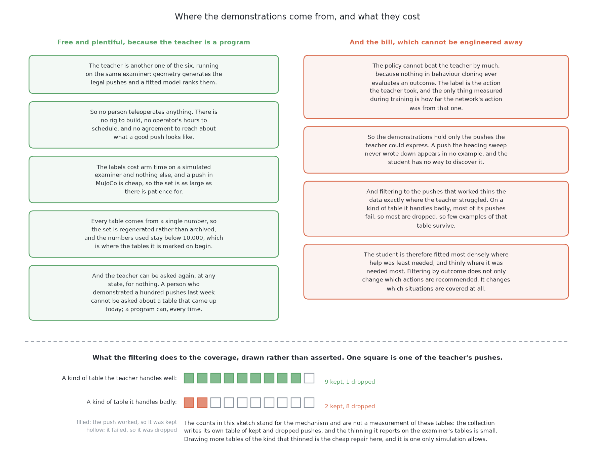

# What it is

> **What it uses.** It uses [LeRobot](https://github.com/huggingface/lerobot),
> a library of robot policies, with PyTorch underneath. The model is **ACT**,
> an action chunking transformer. It predicts a short run of future actions in
> one go, not one action at a time. A second model, **Diffusion Policy**, is
> also in LeRobot. Nothing is downloaded except the library. Both models start
> from random numbers and learn only from examples made in this project.
> **What it does.** The arm is shown many examples of good pushes, and a
> network is trained to copy them. The examples come from
> [geometry generates, a model ranks](../05_geometry-generates-a-model-ranks/01_what-it-is.md).
> The trained policy maps the camera picture straight to a short run of jaw
> waypoints. It holds no geometry, no friction model and no list of candidates.
> **How the output is produced.** A picture of the table from the top goes in.
> The policy returns an **action chunk**, which is a short run of jaw
> waypoints predicted together. The examiner follows those waypoints as they
> are. Then the arm looks again, and the new picture is the next input. One
> push is one chunk.
> **What it costs.** The examples cost only simulated arm time, because the
> teacher is a program. Training took hours on an Apple M4, with no rented
> machine. The real costs are two. The policy cannot do much better than its
> teacher, and the examiner had to gain two new parts.

> **The cell is described once, in [the cell](../../08_seeing-the-glasses/01_the-cell.md).**
> That page gives the layout, the two camera positions, all four sensors, and
> the words this project uses for them. This page covers only what is special
> to this solution.

## Contents

1. [Introduction](#1-introduction)
2. [A film of one table](#2-a-film-of-one-table)
3. [The problem this solves](#3-the-problem-this-solves)
4. [The main idea](#4-the-main-idea)

## 1. Introduction

This chapter explains how to [push the glasses
apart](../01_the-problem/01_what-is-asked-for.md) by copying examples. The arm
is shown many good pushes, and a model is trained to copy them. This method is
called **behaviour cloning**. It is the simplest kind of learning. There is no
reward, no trial and error, and no physics. There is only a large table of
situations and the action taken in each one.

The chapter is for a reader who has read [the problem](../01_the-problem/01_what-is-asked-for.md)
and the chapter on the teacher. Its pages build on each other, so read them in order.

All of this is built. The [examiner](../01_the-problem/03_the-examiner.md) is
built. So is the teacher, [geometry generates, a model
ranks](../05_geometry-generates-a-model-ranks/01_what-it-is.md). The examiner
also gained the two parts this policy needs. One is a picture from straight
above (`bench/top_view.py`). The other is a way to follow a chunk of waypoints
(`Bench.follow`). ACT was trained here and tested on tables it never saw. The
code is in `code/src/09_pushing-the-glasses-apart/03-imitation-from-demonstrations/`.
This chapter gives the score once, in [how it
compares](06_how-it-compares.md#3-where-it-sits-among-the-other-five). The
code folder's `README.md` has every count.

Three parts are still plans, not code. They are the DAgger round, the force
monitor that would watch a chunk while it runs, and giving extra weight to
crowded tables. Each page says so where it comes up.

This solution asks a question the other five cannot ask. The teacher is a
program that chooses pushes well. If a network that only copies it comes
close to it, then a good push can be learned from a picture. If the network
falls far short, that tells us something about this kind of policy. We learn
this before trying the expensive solutions.

The next section shows what the trained policy does on one real table.

## 2. A film of one table

The introduction described the method, and this film shows the result on one
table. The film plays at one and a half times real speed.

[A policy copied from demonstrations, on one table, 23 seconds and no sound](https://docs.dodao.io/videos/pushing-the-glasses-apart/03-imitation-from-demonstrations.mp4 "video")

The table holds six glasses. Five of them have no room at the start.

The policy spends fourteen pushes and racks one glass. That glass already had
room. Most pushes stop while the jaw is still coming down. This happens because
the chunk puts the jaw over a neighbour, not behind the target. The arm touches
something and goes back up. Then it asks for a new chunk from the same picture.
So the film shows the same attempt again and again.

The film is from seed 0, one of three trained copies. [The six
films](../10_the-results.md#3-the-six-films-all-of-the-same-table) shows all
six solutions on this same table and explains how it was chosen.

The next section says which problem copying examples is meant to solve.

## 3. The problem this solves

The film showed the policy failing, so this section says what it was meant to
do. [The problem](../01_the-problem/01_what-is-asked-for.md) asks for one jaw
motion after another, until every glass has room or has been refused with a
reason. So we need a function from a picture of a crowded table to a jaw motion.

That function is hard to write by hand. The result of a push depends on
friction, and [no solution is ever told the
friction](../01_the-problem/02_what-goes-in-and-what-comes-out.md#4-what-a-solution-is-never-told).

The teacher handles this by generating safe pushes and ranking them. But a
person had to write the generator and choose what the ranker sees. Each of
those choices puts a person's idea of pushing into the method, and that idea is
incomplete.

**This solution attacks the same problem from the other end.** Nobody can write
down a good push. But the examiner can tell afterwards whether a push was good,
because [it marks the
outcome](../01_the-problem/03_the-examiner.md#4-the-score-is-the-outcome-not-the-action).
So we can collect good pushes, and fit a network to them.

Two more things make this solution different from its teacher.

**The policy learns the motion, not only the choice.** The teacher gives a few
numbers, and the examiner's macro turns them into a full motion. A policy that
gives waypoints is not limited to that macro. For example, it can slow down
near a neighbour. A chunk is already a full jaw path, so [nothing has to
expand it](../01_the-problem/02_what-goes-in-and-what-comes-out.md#6-what-must-come-out).

**The policy reads the picture.** The teacher works from the numbers `look()`
returns. This policy reads an image. An image shows things the numbers do not,
such as the shape of the gap between two glasses. Nobody has to name those
things for the network to use them.

The next section puts the whole idea into one sentence.

## 4. The main idea

The problem above leads to one idea. **Run the teacher over the training
tables, and keep the pushes that worked. Then fit a network that maps a picture
of the table to the next short run of jaw waypoints.**

Three things follow from this idea, and the rest of the chapter explains them.

**The teacher is a program.** The examples do not come from a person. They come
from another of the six solutions, on training tables only. This changes the
cost of the method a great deal.

**The answer is a chunk, not one action.** The policy returns a short run of
waypoints, predicted together. This keeps the push going in one direction.
[Action chunking](03_how-it-works.md#4-action-chunking-and-why-it-matters)
explains why a push needs that.

**The loop does not change.** Every solution runs the same loop: [plan, feel,
look again](../01_the-problem/05_pushing-without-toppling.md#5-the-loop-plan-feel-look-again).
This solution replaces only the planning step. The loop is what keeps small
copying errors from growing, as [compounding
error](03_how-it-works.md#6-compounding-error) explains.

The next pages show the code and explain how each part works.

← [Geometry generates, a model ranks — how it compares](../05_geometry-generates-a-model-ranks/06_how-it-compares.md) · [How it works](03_how-it-works.md) →
