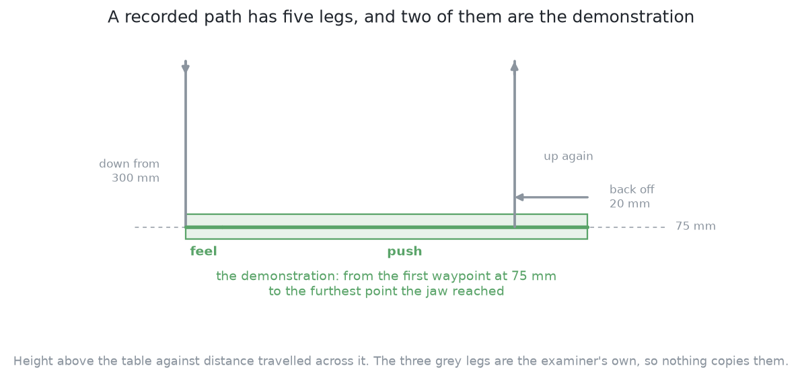
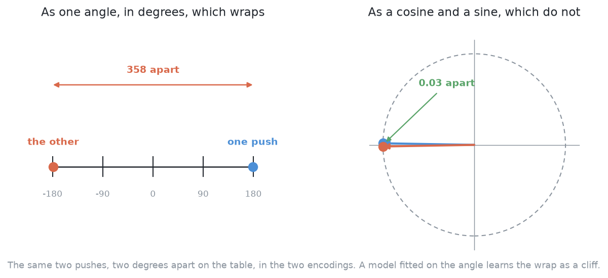

# The code

This page shows the main code of this solution. Then it says what the solution
hands back to the rest of the cell. Last, it joins the two into one pipeline.
They share a page because each one helps explain the other.

## Contents

1. [The code at the heart of it](#1-the-code-at-the-heart-of-it)
2. [The pushes are what this contributes](#2-the-pushes-are-what-this-contributes)
3. [How the concepts fit together](#3-how-the-concepts-fit-together)

## 1. The code at the heart of it

This section comes first because the whole solution depends on one join. A
demonstration is the path the jaw really followed, written down waypoint by
waypoint. A policy's answer is an **action chunk**, a block of numbers of fixed
shape. This solution's own code turns the first into the second for training.
It also turns the model's answer back into waypoints. One call reaches into
the borrowed library.

The join has six steps.

1. Pick out every waypoint the jaw took at push height, and give up on a path
   that never got down there.
2. Find where the push ended, by reading the furthest the jaw travelled, and
   keep only the waypoints from the start of the push up to that point.
3. Write what is left as the five columns the policy is fitted on, and stretch
   or squeeze that run onto the chunk's fixed length.
4. Ask LeRobot for its ACT model, fixing how long an answer is, saying that the
   whole of it is carried out, and switching off the two LeRobot defaults this
   solution will not have.
5. Put the fitted model into answering mode, hand it one picture of the table,
   take one chunk back, and turn the model's own numbers into the units the
   table is measured in.
6. Pull every waypoint back onto the table and into the band of heights the jaw
   works at, count the ones pulled in, turn the cosine-and-sine pair back into
   one angle, and hand the examiner waypoints in its own shape.

Steps 1 to 3 are in
[`code/src/09_pushing-the-glasses-apart/03-imitation-from-demonstrations/chunks.py`](../../../code/src/09_pushing-the-glasses-apart/03-imitation-from-demonstrations/chunks.py).
That file holds no model and no geometry of pushing. Steps 4 and 5 are in
`policy.py`. Step 6 is in `chunks.py` again. The code blocks below carry the
same step numbers.

Steps 1 and 2 are one function, `push_segment`. It drops the parts of a path
that the examiner does by itself. Step 1 gives up on a path that never reached
push height, because a push blocked on the way down shows nothing. In step 2,
the first and last waypoints at push height mark the part worth keeping. The
furthest point the jaw reached is where the push ended. After that, the jaw
only backs off. So the descent, the back-off and the lift are all dropped,
because the examiner does all three itself.



Step 3 uses two functions in the same file. `to_action` writes each waypoint as
five numbers. `resample` stretches or squeezes the run to the chunk's fixed
length. This is the only step that changes how fast the push is replayed.

```python
def push_segment(waypoints: tuple[Waypoint, ...]) -> tuple[Waypoint, ...]:
    """The feeling-and-pushing part of a recorded path, with the back-off and lift off.
    ...
    """
    # Step 1: pick out every waypoint the jaw took at push height -- the push itself is in there
    low = [i for i, point in enumerate(waypoints) if point.z <= PUSH_HEIGHT + AT_PUSH_HEIGHT]
    # Step 1: a path that never got down there holds no push, so hand nothing back
    if len(low) < 2:
        return ()
    # Step 2: the first and last of those bracket the time the jaw spent at push height
    start, end = low[0], low[-1]
    # Step 2: measure how far the jaw had travelled from the start of the push at each of them
    origin = waypoints[start]
    gone = [math.dist((p.x, p.y), (origin.x, origin.y)) for p in waypoints[start : end + 1]]
    # Step 2: the furthest it got is where the push ended and the back-off began
    furthest = start + int(np.argmax(gone))
    # Step 2: keep the start of the push up to that point, and drop everything after it
    return tuple(waypoints[start : furthest + 1]) if furthest > start else ()

def to_action(waypoints: tuple[Waypoint, ...]) -> np.ndarray:
    """A run of waypoints as the (n, 5) numbers a policy is fitted on."""
    # Step 3: write each waypoint as five numbers -- where the jaw is, then its heading as a
    # cosine and a sine, which is a pair that does not jump when the angle wraps round
    return np.array(
        [[p.x, p.y, p.z, math.cos(p.heading), math.sin(p.heading)] for p in waypoints],
        dtype=np.float32,
    )
```

There are five columns, not four. The first three say where the jaw is. The
last two give its heading, which is the direction the jaw points. The heading
is stored as its cosine and its sine, not as an angle. This is because an
angle wraps round. Two pushes two degrees apart can get numbers at opposite
ends of the range. A model would then learn a sudden jump that is not in the
pushes. The cosine and sine do not wrap, so the jump goes away.



The borrowed model is used in one file,
[`code/src/09_pushing-the-glasses-apart/03-imitation-from-demonstrations/policy.py`](../../../code/src/09_pushing-the-glasses-apart/03-imitation-from-demonstrations/policy.py).
Step 4 builds LeRobot's ACT with four settings. Two settings fix the length of
an answer and say that all of it is carried out. The other two switch off
LeRobot defaults. Step 5 asks the trained model for one chunk from one picture.
Then it turns the model's numbers back into table units.

```python
    if kind == "act":
        from lerobot.policies.act.configuration_act import ACTConfig
        from lerobot.policies.act.modeling_act import ACTPolicy

        # Step 4: ask LeRobot for its ACT model -- the one borrowed piece of this solution
        return ACTPolicy(
            ACTConfig(
                input_features=inputs,
                output_features=outputs,
                # Step 4: the answer is one block of this many waypoints
                chunk_size=chunk,
                # Step 4: carry the whole block out, because one push is one chunk
                n_action_steps=chunk,
                # Step 4: start the vision part from random numbers, downloading nothing
                pretrained_backbone_weights=None,
                # Step 4: leave the library's own scaling off; this folder scales the numbers
                normalization_mapping=_UNTOUCHED,
                push_to_hub=False,
            )
        )
...
    def chunk(self, picture: np.ndarray) -> np.ndarray:
        """One action chunk from one picture: (chunk, 5) in the table's own units."""
        # Step 5: switch the model from being fitted to answering
        self.net.eval()
        with torch.no_grad():
            # Step 5: hand it the scaled picture of the table and take one chunk back
            answer = self.net.predict_action_chunk(self.batch(picture))
        # Step 5: turn the model's -1 to 1 numbers back into the table's own units
        return self.scale.back(answer[0].float().cpu().numpy())
```

Three settings differ from LeRobot's defaults, and the rest of the model is
LeRobot's own.

- `pretrained_backbone_weights=None` stops ACT from downloading ImageNet weights
  for its vision part. This is why the model truly starts from random numbers.
- `normalization_mapping` leaves the scaling to this solution's own code.
- `n_action_steps` is set to the full chunk length. One push is one chunk, and
  nothing re-plans in the middle.

Step 6 is the way back, in `to_waypoints` in `chunks.py`. A network can ask for
a position the arm cannot reach. So step 6 pulls every waypoint back onto the
table and into the jaw's height range. It counts the waypoints it pulled in, so
that a bad chunk is reported and not hidden. Then it turns the cosine and sine
back into one angle.

```python
def to_waypoints(action: np.ndarray) -> tuple[tuple[Waypoint, ...], int]:
    """A policy's chunk as waypoints the bench will accept, and how many it had to pull in.
    ...
    """
    ...
    # Step 6: pull every waypoint back onto the table and into the heights the jaw works at
    inside = np.stack(
        [
            np.clip(action[:, 0], TABLE_CENTRE_XY[0] - half_x, TABLE_CENTRE_XY[0] + half_x),
            np.clip(action[:, 1], TABLE_CENTRE_XY[1] - half_y, TABLE_CENTRE_XY[1] + half_y),
            np.clip(action[:, 2], PUSH_HEIGHT, TRAVEL_HEIGHT),
        ],
        axis=1,
    )
    # Step 6: count the waypoints that had to be pulled in, so the number can be reported
    pulled = int(np.any(np.abs(inside - action[:, :3]) > 1e-9, axis=1).sum())
    # Step 6: turn the cosine and sine pair back into one heading angle
    headings = np.arctan2(action[:, 4], action[:, 3])
    # Step 6: hand back waypoints in the bench's own shape, with the count of pulled-in ones
    points = tuple(
        Waypoint(float(x), float(y), float(z), float(heading))
        for (x, y, z), heading in zip(inside, headings, strict=True)
    )
    return points, pulled
```

These three blocks show where the trained policy goes wrong. The first two
columns come out about right, so the fingertips land near where the teacher put
them. The heading comes out about 25 degrees away from the teacher's. On a
crowded table, that turns the jaw over a neighbour while it comes down, so the
push stops before any glass is touched. [The heading
error](04_a-worked-example.md#2-a-worked-example) works this through with real
sizes.

The next section says what this code hands back to the rest of the cell.

## 2. The pushes are what this contributes

The code above makes waypoints, so this section says what those waypoints are
compared against.

**This solution gives waypoints, and nothing expands them.** Other solutions
give a few numbers, and the examiner's macro turns them into a motion. A chunk
is already [a full jaw
path](../01_the-problem/02_what-goes-in-and-what-comes-out.md#6-what-must-come-out),
so the examiner follows it as given, through `Bench.follow`.

**Two small things travel beside the waypoints, and the policy does not make
them.** The scorecard needs to know which glass a push was for, and where that
glass was meant to end up. The policy gives neither. So both are read off the
chunk afterwards. The glass is the one the jaw ends up against. The aim is the
last fingertip point moved forward by half the glass's width. [One fixed
nudge](../04_one-fixed-nudge/01_what-it-is.md) uses the same rule. This is only
bookkeeping, and it never changes the motion.

**The examiner scores the table, not the action.** This is why a push of three
numbers and a chunk of 120 waypoints can be compared at all. [The
examiner](../01_the-problem/03_the-examiner.md#4-the-score-is-the-outcome-not-the-action)
explains this rule.

**Everything else is shared, so a change in the score comes from the policy.**
The tables and the measurements are the examiner's. The measurements carry the
error of [telling the glasses
apart](../../08_seeing-the-glasses/11_the-results.md). The destinations come
from [the target layout](../01_the-problem/04_the-target-layout.md). The topple
limit and the refusal rule come from [pushing without
toppling](../01_the-problem/05_pushing-without-toppling.md). This solution adds
only one mapping, from a picture to a short run of waypoints.

The target layout and the macro never appear inside the network. But the
teacher aimed at the layout, and the macro made the waypoints the network
copied. So **the policy can at first only make the motions the macro made.**
Anything new must come from blending its examples.

The next section joins the code and the output into one pipeline.

## 3. How the concepts fit together

The two sections above described the parts, and this one joins them. The
pipeline has an offline half that runs once and an online half that runs on
every push. Almost all the cost is in the first half. Almost all the risk is in
the second.

**Offline, and once.** Tables are drawn from the training numbers. The teacher
runs over them. For every push, three things are recorded: the picture from the
top, the waypoints the jaw followed, and the examiner's verdict. Failed pushes
are dropped, and the drops are counted. Refusals are kept as refusals. What is
left is a set of pairs: a picture and a chunk of waypoints.

A recorded path has a few hundred waypoints, but a chunk has a fixed, shorter
length. So every path is cut to the part at push height and resampled to the
chunk's length. Waypoints are followed at a fixed rate, so squeezing a long push
makes it run faster. For this reason, the chunk length is set near the median
length of the teacher's pushes.

ACT is then trained on this data from random numbers, for hours. It is trained
several times with different seeds, because [one run is not a
measurement](../01_the-problem/03_the-examiner.md). Diffusion Policy would use
the same data with a different model.

**Online, on every push.** The arm looks at the table and racks every glass that
already has room. Then the shared topple limit is checked on every glass still
standing. A glass that fails is refused with its reason. Only then does the
picture go into the policy, which returns one chunk. The chunk is charged to a
glass the limit left in play, so a refused glass is never pushed. The jaw comes
down to the first waypoint, follows the waypoints, and lifts clear. It reports
what it felt, in the same words a normal push uses. Then the arm looks again.
The loop stops when every glass has room, or the rest are refused, or the push
budget is spent.

Two points sum up the pipeline.

**Nothing in the method models pushing.** The policy holds no friction value,
no slide prediction, no candidates and no geometry. It holds a mapping, not an
understanding. Of the six, it needs the least knowledge from its builder.

**The policy can only be as good as its teacher.** [Where it is strong and
where it breaks](06_how-it-compares.md#1-where-it-is-strong-and-where-it-breaks)
explains why.

The next page explains how each of these parts works.

← [What it is](01_what-it-is.md) · [How it works](03_how-it-works.md) →
