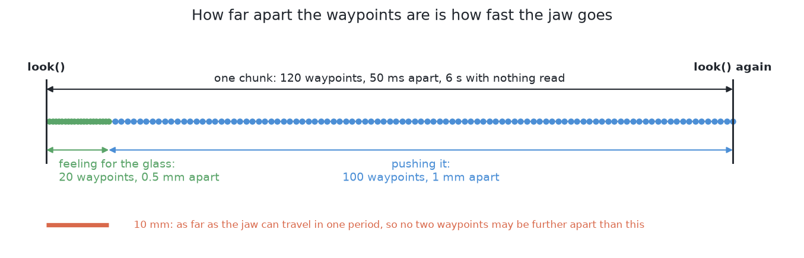
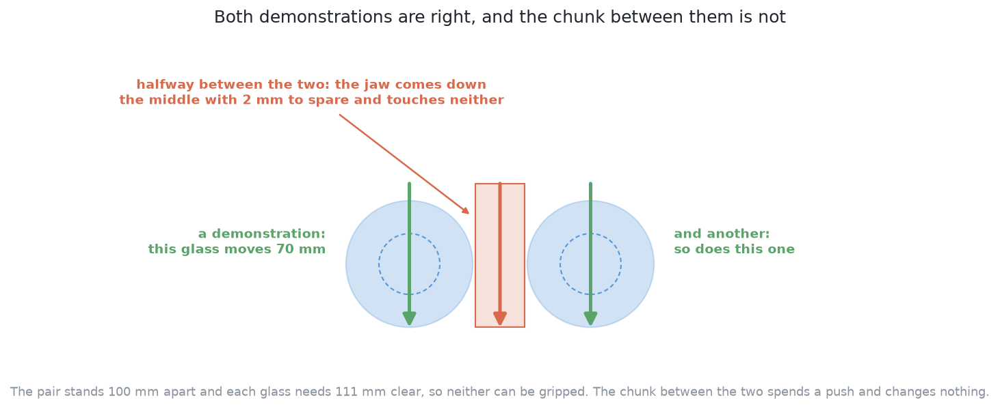

# How it works

This page explains what happens inside this solution, part by part. It follows
[the code](02_the-code.md) and says why each part of that code is there.

## Contents

1. [Behaviour cloning — learning a policy by copying](#1-behaviour-cloning--learning-a-policy-by-copying)
2. [Where the demonstrations come from](#2-where-the-demonstrations-come-from)
3. [Choosing which demonstrations to keep, and the bias it buys](#3-choosing-which-demonstrations-to-keep-and-the-bias-it-buys)
4. [Action chunking, and why it matters](#4-action-chunking-and-why-it-matters)
5. [A second way — Diffusion Policy](#5-a-second-way--diffusion-policy)
6. [Compounding error](#6-compounding-error)

## 1. Behaviour cloning — learning a policy by copying

Behaviour cloning is the whole of this solution, so this page starts with it.

A **policy** is a function from what the arm sees to what the arm should do.
**Behaviour cloning** fits that function from examples of someone else doing
the job. Each example is a pair: what was seen, and what was done. The first
part is the input and the second part is the label. Training works like any
other supervised learning. The network makes an answer, the answer is compared
with the label, and every weight is moved a little to close the gap.

In programming terms, you are given a lookup table and asked to answer queries
that are not in it. The table holds situations and the right action for each.
The network is a smooth, compressed copy of the table. The method hopes that a
smooth guess between the entries is a good one.

Three things make this method attractive here. Each one is something it does
not need.

**It needs no reward.** Reinforcement learning needs a number that scores each
outcome. That number is hard to write, because the learner chases the number
and not the intent. For example, a reward for moving glasses apart fast
rewards shoving. Behaviour cloning needs no such number. Training only measures
how far the network's action is from the teacher's.

**It needs no trial and error.** A learner that tries things must try bad
things. Here, one bad thing cannot be undone: nothing stands a toppled glass up
again. Behaviour cloning never tries anything while it trains. It only reads
examples.

**It needs no physics.** Friction appears nowhere in this method. The examples
were made in a world with friction, so the effects of friction are in the data.
The network can use those effects without knowing the number. Compare [a world
model, then plan with it](../07_a-world-model-then-plan-with-it/01_what-it-is.md),
which learns how the world changes. This solution does not predict what a push
will do. It only predicts what the teacher would have done.

Against those three strengths there is one weakness. Every later section
follows from it.

**A cloned policy only knows the situations its teacher visited.** Inside that
region, a guess between examples is reasonable. Outside it, the network still
gives an answer, but nothing supports that answer. Worse, **the output does not
say which case you are in.** The policy gives a chunk either way, with the same
confidence. So its mistakes give no warning.

The next section asks where the examples come from, because the method needs
many of them.

## 2. Where the demonstrations come from

Behaviour cloning needs many examples. In most of robotics, collecting them is
what makes the method too costly. Here they are almost free, and this section
explains why.

**The teacher is [geometry generates, a model
ranks](../05_geometry-generates-a-model-ranks/01_what-it-is.md).** It makes safe
candidate pushes from geometry and ranks them with a trained model. The examiner
carries out each push and records the waypoints the jaw followed. Then it marks
what happened to the table. So **every push the teacher makes is already a
finished example**: a picture before the push, the waypoints, and the verdict.

Six things follow from this.

**The only cost is simulated arm time.** There is no human operator and no
teleoperation rig. The examiner runs in MuJoCo, which is fast. [The
examiner](../01_the-problem/03_the-examiner.md) explains why a learned method
needs that speed.

**The examples can be made again.** Each table comes from one number. The same
number always gives the same table. So the data can be rebuilt instead of
stored.

**Training and testing stay apart.** Examples come only from tables below the
dividing line. Tests use only tables above it. So no policy is ever marked on a
table it learned from.

**The examples come from one fixed band of tables.** A **demonstration band**
is the run of table numbers that a solution's examples come from. This
solution's band is tables 1000 to 6199. It starts at 1000 for a reason. The
teacher's own ranker was fitted on tables 0 to 199. On those tables the teacher
is at its best, so they would flatter the examples. A second band, from table
8000, is kept back to check the student against the teacher. Both bands are
set in `collect.py`.

Two solutions that learn from examples must use the same band before they are
compared. If the bands differ, the comparison measures the data as well as the
method. [SmolVLA fine-tuned](../09_the-same-model-fine-tuned-here/03_how-it-works.md#3-where-the-demonstrations-come-from-and-what-they-cost)
now uses this band for that reason.

**The teacher can be asked again, about any table.** A person cannot say what
they would have done on a table they never saw. A program can, at no cost.
[Compounding error](#6-compounding-error) uses this.

**The teacher is one of the seven.** So student and teacher can be compared on
the same tables, with the same scorecard.

There is one limit to all of this. **It is true only in a simulator with a
program as teacher.** On a real arm with a human teacher, collecting examples
is usually the biggest cost of the whole method.

The next section asks which of these free examples should be kept.

## 3. Choosing which demonstrations to keep, and the bias it buys

The examples are free, but a good set of examples still needs choosing. This
section explains the choice and the bias it brings.

**A cloned policy copies everything in its data.** It has no idea of a good or
bad action. It only has labels to copy. The teacher is not perfect. Some of its
pushes topple a glass, push one out of the zone, or jam. If those stay in the
data, the student learns to make them. So only the pushes the examiner marked
as good are kept.

That choice is right, but it has a cost.

**Keeping only good pushes also changes which tables are covered.** Suppose the
teacher handles one kind of table badly, such as glasses crowded into a corner.
Most of its pushes there fail and are dropped. So the data holds few examples of
that kind of table. The student learns most about tables where the teacher was
already strong. It learns least where help was most needed.

On these tables, this bias turned out to be small. Most of what is dropped is
not a failure at all. It is the teacher's 5 mm test push, which only checks
whether a glass slides. Of the real pushes, only a few in a hundred were
dropped. The code folder's `README.md` gives the counts.

The bias is small but not zero, so there are three ways to reduce it. Two are
done and one is still a plan.

**Keep the teacher's refusals as refusals.** A glass the teacher declined to
push is not a failure. [A refusal is a
result](../01_the-problem/05_pushing-without-toppling.md). **Done:** the
refusals and their reasons are counted beside the examples.

**Count what was dropped, by kind of table.** The thinning is invisible unless
it is counted. **Done:** the collection writes this table, and it gave the
small numbers above.

**Give extra weight to crowded tables, and collect more of them.** Tables come
from numbers and cost only time. So a thin region can be filled by drawing more
tables of that kind. This puts the hardest cases in the middle of what the
policy learned, not at its edge. It is the cheapest fix here, and it is not
possible on real hardware. **Not done:** the examples come from consecutive
table numbers. So crowded corners are as rare in training as they are in tests.

None of the three fixes removes the limit that the teacher sets. The next
section turns from the input data to the shape of the output.

## 4. Action chunking, and why it matters

The data is now chosen, so this section looks at what the policy gives back.
That output is the second thing that defines this solution.

**Action chunking** means predicting a short run of future actions at once.
The network is asked once and returns several waypoints together. The arm
follows all of them before it asks again.

In programming terms, there are two ways to write a controller. One is a
function called on every tick that returns only the next step. The other is a
function called once that returns several steps of a plan. The second one
**commits**. It cannot change its mind in the middle.

Committing helps a push in particular. **A push only works if it keeps going.**
A glass moves because the jaw keeps travelling in one direction, in contact.
A policy that decides again at every tick has no memory of why it was going
that way. Two failures follow.

The first failure is **dithering**. Small differences between one decision and
the next make the jaw wander instead of travel.

The second failure is harder to see. The teacher may have pushed left in one
example and right in another, from tables that look alike. A network asked for
one best next step reduces its error by choosing something in between. **The
average of two good choices is often not a good choice.** Chunking does not
remove this problem. But it moves the averaging to once per push, instead of
once per tick.

Chunking brings one more benefit and one cost.

**Errors do not build up inside a chunk.** All the waypoints in a chunk are made
together, so they agree with each other. A step-by-step policy makes each new
step from a state its own last step made. [Compounding
error](#6-compounding-error) explains why that matters.

**A chunk runs open-loop.** This means nothing is read while it runs. The arm
follows a plan made from a picture that is now old. If something unexpected
happens partway through, the rest of the chunk does not know. So chunk length is
a real trade. A long chunk is committed but blind. A short chunk reacts more but
dithers more.

Chunk length is also a trade in speed. Waypoints are followed at a fixed rate,
so the gap between them sets the jaw's speed. The examiner caps that speed at
the fastest the cell ever moves the jaw. If waypoints are further apart than the
arm can cover in one step, the chunk is run more slowly. This policy never
meets the cap, because the teacher's waypoints are about a millimetre apart and
the cap is at ten.

`Bench.follow` limits the risk of a blind chunk, but less than the normal push
does. The jaw comes down to the first waypoint, and it stops if it touches
anything on the way. So a chunk that starts above a glass is reported as
blocked. But **once the jaw moves across the table, the examiner does not feel
for the glass.** The chunk is followed as given. Only the jam threshold can stop
it. So the slow approach to a glass comes from the chunk, copied from the
teacher. Here the solution relies on its examples for safety, not on the
examiner.

A force monitor could watch the jaw during a chunk and stop it early. [The
early abort](../01_the-problem/05_pushing-without-toppling.md#an-early-abort-acting-during-the-push)
describes it. It is a plan and not code. This solution needs it more than any
other, because nothing else watches a chunk while it runs.

Chunking is also why [the
examiner](../01_the-problem/02_what-goes-in-and-what-comes-out.md#6-what-must-come-out)
accepts waypoints at all. Forcing a chunking policy into three or four push
numbers would remove the thing that makes it work.

The next section describes a second model, built to fix the averaging problem
named above.

## 5. A second way — Diffusion Policy

The section above showed that averaging two good pushes can give a bad one.
Diffusion Policy is a second model built to avoid this. **It starts from a
chunk of pure noise, and removes a little noise many times, until a sensible run
of waypoints is left.** The result depends on the starting noise. So asking
twice can give two different good answers.

That is the whole case for it. A model trained to give one answer averages the
answers it saw. This problem has several good answers almost everywhere. The
picture below shows one case. Two glasses stand too close to grip. The teacher
has two good answers that mirror each other: move one glass, or move the other.
The chunk halfway between them sends the jaw down the gap between the two
glasses. It touches neither glass, and the push is wasted.

ACT's measured heading error, about 25 degrees, fits this kind of averaging.
[The worked example](04_a-worked-example.md#2-a-worked-example) gives the
measurement.

**Diffusion Policy is written and it runs, but it has not been trained here.**
It is in `policy.py` beside ACT and uses the same examples. The two models are
about the same size. The reason is compute. One training step costs about twice
as much. One chunk at run time needs sixteen denoising passes instead of one.
And a result needs several seeds. So it has no score yet.

The next section turns to the main way behaviour cloning fails over a whole run.

## 6. Compounding error

The sections above looked at one push at a time. This section looks at a whole
run. It builds on the weakness named in the first section: a cloned policy only
knows situations its teacher visited.

Here is how it fails, step by step. No trained network copies its labels
exactly. So the policy acts a little differently from the teacher. That puts
the arm in a state the teacher never reached. There, the policy is further from
its examples, so its next action is a little worse. That puts the arm further
out still. **The error feeds back into its own input.** This is called
**compounding error**. It is why a policy that looks good on single decisions
can still fail over a whole run.

In programming terms, compare a rounding error in one sum with a rounding error
in a loop that reads its own last result. The first stays the same size. The
second grows with each pass.

**The loop helps a great deal here.** Every solution in this book acts, looks
at what really happened, and decides again. [The
loop](../01_the-problem/05_pushing-without-toppling.md#5-the-loop-plan-feel-look-again)
describes this. So **the policy is always asked about a measured table, never a
predicted one.** Drift inside a chunk ends when the chunk ends. The next answer
starts from a fresh picture.

The loop weakens the problem but does not remove it. It still harms the policy
in two ways.

**Drift inside a chunk is not seen.** This is the open-loop cost from [action
chunking](#4-action-chunking-and-why-it-matters). A short chunk keeps it small.

**Across pushes, the table itself drifts.** This is the real problem. Looking
again tells the policy where the glasses are. It does not make that table one
the teacher ever produced. Suppose the first push moves a glass further than
the teacher would have. Then the second push is chosen on a table the examples
do not cover. Over a run, the policy walks the table away from what it knows.
Measuring positions well does not help. The state is not unknown. It is
unfamiliar.

**The standard fix is called DAgger, and here it is cheap.** DAgger means
dataset aggregation. Run the policy, and at each state it reaches, ask the
teacher what it would have done. Add those answers to the data as labels. Then
train again, and repeat. The data then covers the places the policy drifts to.

This is cheap here because the teacher is a program. It can be asked about any
table, at any time, for nothing. A human teacher cannot answer questions about
thousands of new tables. So the main weakness of behaviour cloning has a cheap
fix in this project. That comes from the teacher being code, not from imitation
learning in general. DAgger is still a plan here, not code.

The next page follows this solution through one table with real numbers.

← [The code](02_the-code.md) · [A worked example](04_a-worked-example.md) →
