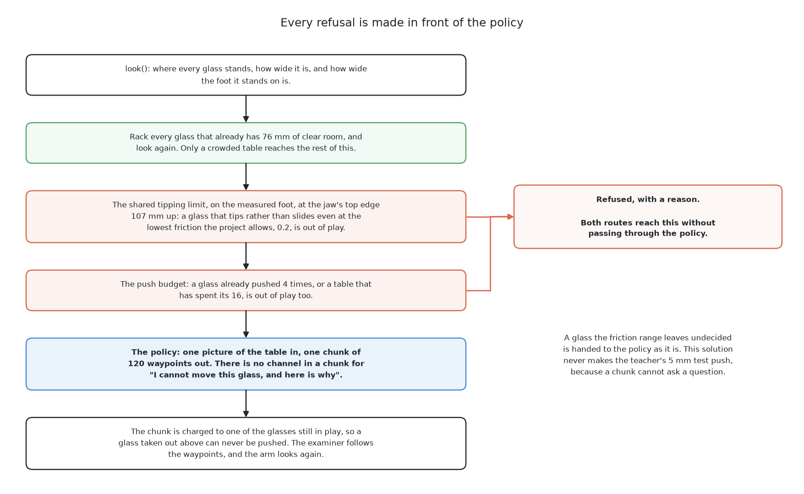
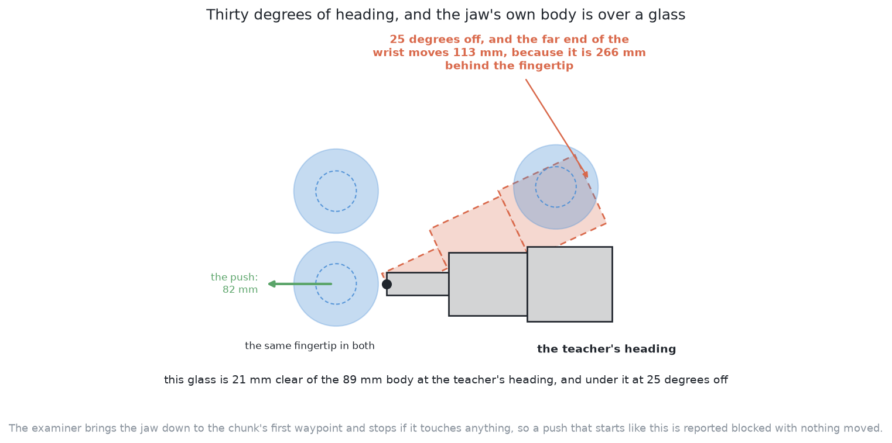

# A worked example

This page follows this solution through one table with real numbers. First it
covers the case this book keeps coming back to: a glass that cannot be pushed
safely. A worked example that shows only the easy case would teach the wrong
lesson. Then it asks why the pushes fail, and tests three answers with
measurements.

## Contents

1. [When a glass cannot be pushed safely](#1-when-a-glass-cannot-be-pushed-safely)
2. [A worked example](#2-a-worked-example)
3. [More pushes would not help](#3-more-pushes-would-not-help)
4. [Most of what the policy learns is where things are](#4-most-of-what-the-policy-learns-is-where-things-are)
5. [Telling the policy where the glasses are](#5-telling-the-policy-where-the-glasses-are)

## 1. When a glass cannot be pushed safely

The hard case comes first, because it shows what a cloned policy cannot say. A
glass slides when the jaw touches it low enough, and tips when the jaw is too
high. [Pushing without
toppling](../01_the-problem/05_pushing-without-toppling.md) sets out that rule
once. This section covers only what is special to this solution.

**This policy has no way to refuse.** Its only output is a chunk of waypoints.
It has no way to say "I cannot move this glass, because it would tip". But the
examiner wants every refusal to come with a reason. So the answer the examiner
needs is one this policy cannot give.

The policy does not learn to refuse by itself either. The teacher refuses those
glasses, so the data holds no push on them. But **a missing example is not a
label.** The network was never shown such a glass with the label "do nothing".
It was shown nothing at all. When asked about such a glass, it returns a chunk,
because that is all it can do. So the one case where the arm must not act is
the case where the policy knows least.

So the refusal is made in front of the policy. It uses the same arithmetic as
the two solutions before this one. The policy is never asked about a glass that
fails it. The push budget, and the limit on pushes per glass, also act in front
of the policy.

There is one more cost of the same limit. Sometimes the friction range leaves
the answer undecided. The teacher then makes a 5 mm test push and looks before
and after. This solution makes no test push, because a chunk cannot ask a
question. So the gate refuses only the glasses that tip even at the lowest
friction allowed. An undecided glass goes to the policy as it is.

No force monitor watches a chunk while it runs. [Action
chunking](03_how-it-works.md#4-action-chunking-and-why-it-matters) explains why
this solution needs one most.

The next section follows one whole table, where the refusal is only one part.

## 2. A worked example

The refusal above is one case, and this section follows a whole table. The
places where this solution differs from its teacher are easier to see on a real
table. This example was written before the policy was trained, so it shows what
the design expected. The end of the section says what really happened.

**The table.** Five straight glasses stand in the glass zone, in a range of
sizes. Two of them stand too close for the gripper, with a small gap still
between them. One of that pair is also near the edge of the zone. The other
three have room.

**What happened offline.** Before this table was drawn, the teacher ran over
many training tables. The failures were dropped and counted. ACT was trained on
the rest, several times with different seeds. None of that used this table,
which is a test table.

**The first push, as designed.** The policy returns one chunk. The jaw comes
down behind the outer glass of the close pair and feels forward slowly. It
slides the glass away from its neighbour. Then it backs off and lifts. A chunk can do things a
normal push cannot. For example, it can curve the slide, or slow down near the
end. Whether that helps is something to measure.

**What the push does, as designed.** The glass goes further than the teacher
aimed, because the friction under it differs from the examples. Nothing in this
method models friction. Nothing is lost, because the arm looks again and sees
where the glass really is.

**Compounding error, as designed.** The table now has a glass closer to the zone
edge than the teacher would ever leave one. If the examples held tables like
this, the next push is as good as the first. If not, the policy is outside its
data. It will still answer, with the same confidence as before. [Compounding
error](03_how-it-works.md#6-compounding-error) explains this failure and the
DAgger fix.

**The refusal.** Take a different table, of stemmed glasses. One has a foot so
narrow that it would tip at any likely friction. The shared arithmetic checks
this from the measured foot width before the policy is asked. It refuses the
glass with its reason. The policy never sees it. The other glasses are pushed as
usual, and the table ends *correct but incomplete*. That is the right result.
Nothing the policy learned could improve it, and nothing it produced could make
it worse.

**What really happened.** The refusal works as described. The first push does
not. The trained policy starts its chunk in roughly the right place. But it
points about 25 degrees away from the teacher. Across the three seeds, this
error is 22 to 27 degrees on tables the policy never saw. On tables it was
trained on, it is under 4 degrees. Its waypoints sit 48 to 52 mm from the
teacher's at the median. These figures are in the project's
[`README.md`](https://github.com/RobinNagpal/robot-arm-projects/blob/main/v5-pick-glasses/03-push-glasses-apart/03-imitation-from-demonstrations/README.md#what-the-fitting-cost-and-what-it-bought).

This matters because the hand is long. It reaches 266 mm back behind its
fingertips. Turning it 25 degrees about the fingertips swings the far end of the
wrist about 115 mm sideways. On a crowded table, that puts the 89 mm wrist over
a glass that the teacher's heading cleared.

The examiner brings the jaw down to the first waypoint, and stops if it touches
anything. So most pushes end there, before any glass is touched. The curved
slide and the slow finish were never reached. In the run, 331 of 438 pushes
ended this way, at the median of the three seeds. The counts are in
[`results.json`](https://github.com/RobinNagpal/robotics-basics/blob/main/code/src/09_pushing-the-glasses-apart/03-imitation-from-demonstrations/results.json).

The next section asks whether more pushes would let the policy recover from
these failed descents.

## 3. More pushes would not help

The worked example showed pushes that end on the way down. This section asks
whether the policy would do better with more tries.

The question comes from the scorecard. The commonest reason a glass is left on
the table is "push budget spent". The **push budget** is the shared limit: four
pushes for one glass and sixteen for a table. That reason reads as if the
policy was stopped too early.

The project tested this. Each of the three trained seeds ran again on the same
50 test tables, with larger budgets and nothing else changed. The table below
gives glasses racked out of 251. Read each row as one budget, and each column as
one seed.

| budget, per glass and per table | seed 0 | seed 1 | seed 2 |
|---|---|---|---|
| 4 and 16, the shared budget | 64 | 51 | 63 |
| 8 and 32 | 65 | 52 | 64 |
| 16 and 64 | 65 | 52 | 64 |
| 32 and 128 | 66 | 52 | 64 |

**Eight times the budget buys one or two glasses.** The pushes rise from about
440 to about 3,000. So the budget is where a run stops, not why it fails. A
push that is blocked on the way down still costs a push. More pushes only buy
more blocked pushes.

The budget was left at four and sixteen. These are the test tables. A budget
chosen because it scored well on them would make later results less honest.
The numbers come from [the project's own
page](https://github.com/RobinNagpal/robot-arm-projects/blob/main/v5-pick-glasses/docs/03-push-glasses-apart/solutions/03-imitation-from-demonstrations.md#the-commonest-refusal-reason-is-not-the-reason-it-fails).

So the real cause is the blocked descent. The next section asks why the policy
puts the jaw down in the wrong place.

## 4. Most of what the policy learns is where things are

The section above showed that the failed descents are the real problem. This
section asks why the policy's descent point is so hard to learn.

The policy writes each waypoint as a position on the table. The same push can
be written in other ways. It can be written as an offset from the glass being
pushed. That offset can also be turned to line up with the push, so one number
runs along the push and one runs across it. This is the **push's own frame**. A
frame is a choice of where zero is and which way the axes point. The motion is
the same in all three. Only the numbers change.

A target that varies less is easier to learn. So the project measured how much
the teacher's descent point varies, written each way. It used 477 examples from
400 tables. The table below gives the spread in millimetres. Read each row as
one way of writing the same points.

| how the point is written | where the chunk starts | where the chunk ends |
|---|---|---|
| a position on the table | 135.8 mm | 127.8 mm |
| an offset from the glass | 46.2 mm | 39.2 mm |
| that offset in the push's own frame | **7.5 mm** | 25.8 mm |

The first column matters most. The chunk's start is where the jaw comes down.
On the table it varies by 135.8 mm. In the push's own frame it varies by only
7.5 mm. The teacher always brings the jaw down on the line through the glass,
about 46 mm behind its middle. So most of what the policy must learn is where
the table's glasses are. The examiner already measures that.

The second column is different. The end of the chunk still varies by 25.8 mm in
the push's frame. That spread is real. It is how far the teacher chose to push,
and that choice changes from table to table.

Nothing has been trained in the push's own frame yet. It is also not a free
change. The policy would then have to name a glass and a direction, as its
teacher does. That would make it less of a plain copy of a path. The numbers
come from [`measure_frames.py`](https://github.com/RobinNagpal/robot-arm-projects/blob/main/v5-pick-glasses/03-push-glasses-apart/03-imitation-from-demonstrations/measure_frames.py)
and [the project's own
page](https://github.com/RobinNagpal/robot-arm-projects/blob/main/v5-pick-glasses/docs/03-push-glasses-apart/solutions/03-imitation-from-demonstrations.md#most-of-what-the-policy-has-to-learn-is-the-coordinate-system).

The next section tries a smaller change: give the policy the glass positions
directly.

## 5. Telling the policy where the glasses are

The section above found that the policy spends most of its effort on locating
glasses. This section gives it the locations and measures what changes.

The examiner already hands every solution its **readings**: the measured place
and size of each glass. This variant puts those readings beside the picture.
A network needs a fixed number of inputs, but a table holds a varying number of
glasses. So the readings go into six slots, one per glass. Each slot holds six
numbers: two for position, three for size, and one flag that says whether the
slot is used. The model grows by 38,400 numbers, less than one part in a
thousand. The policy still answers with the same waypoints. The code is in
[`readings.py`](https://github.com/RobinNagpal/robot-arm-projects/blob/main/v5-pick-glasses/03-push-glasses-apart/03-imitation-from-demonstrations/readings.py),
in the project only.

The variant was trained three times and run on the same 50 test tables. The
table below compares it with the picture-only policy. Each value is the average
of three seeds unless the row says otherwise.

| | from the picture alone | with the readings |
|---|---|---|
| glasses racked | 59.3 | 61.3 |
| the three seeds | 64, 51, 63 | 61, 65, 58 |
| tables done | 2.0 (1 to 3) | 3.0 (3 every run) |
| aim error, median | 43.9 mm | 37.7 mm |
| jaw travel per run | 2,245 mm | 1,824 mm |
| pushes blocked on the way down | 366.3 | 370.3 |

**The readings made the policy more consistent, not better.** Two more glasses
out of 251 is only 0.4 of the spread between runs. So the score did not move.
What moved is the spread itself. The weak seed is gone. The spread of glasses
racked fell from 7.2 to 3.5.

**The aim improved, but the blocked pushes did not.** The policy aims 6 mm
closer and travels a third less. So it did use the readings. But about 370 of
444 pushes are still blocked on the way down. So the aim is not the limit. The
limit is the straight drop onto the chunk's first waypoint. The jaw hits a
glass on its way down, not at the target.

The picture-only policy stays this solution's result. The variant is recorded
beside it, in
[`results-act-readings.json`](https://github.com/RobinNagpal/robot-arm-projects/blob/main/v5-pick-glasses/03-push-glasses-apart/03-imitation-from-demonstrations/results-act-readings.json).
The project's [README](https://github.com/RobinNagpal/robot-arm-projects/blob/main/v5-pick-glasses/03-push-glasses-apart/03-imitation-from-demonstrations/README.md#the-readings-variant--the-same-fits-told-where-the-glasses-are)
gives the full table.

The next page lists what this solution needs in order to run.

← [How it works](03_how-it-works.md) · [What it needs](05_what-it-needs.md) →
