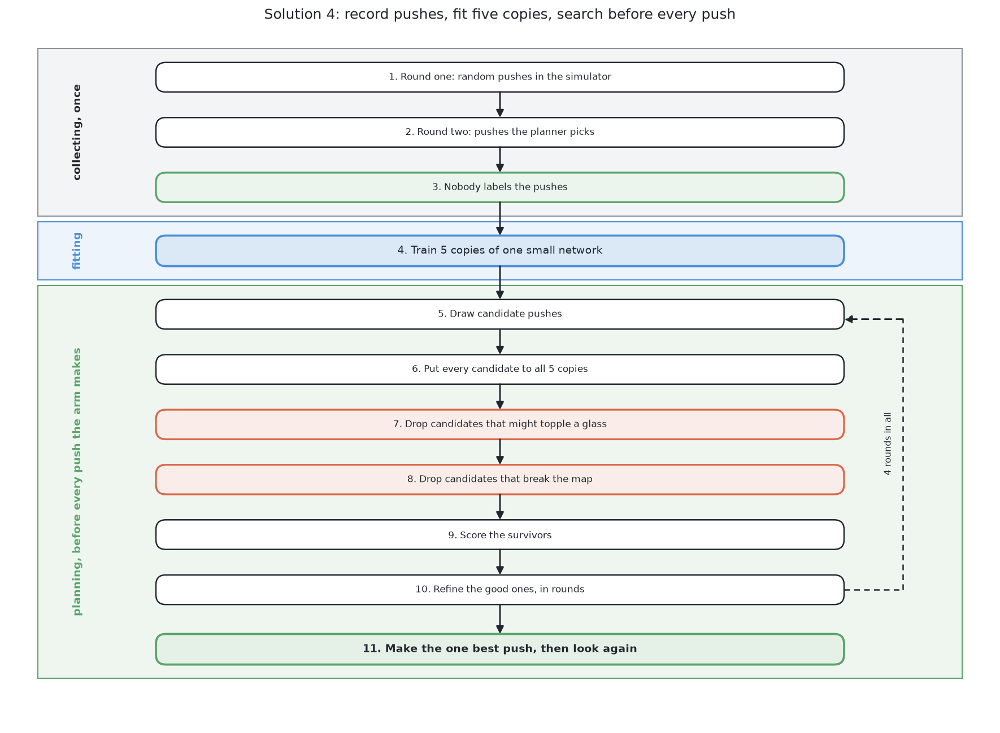
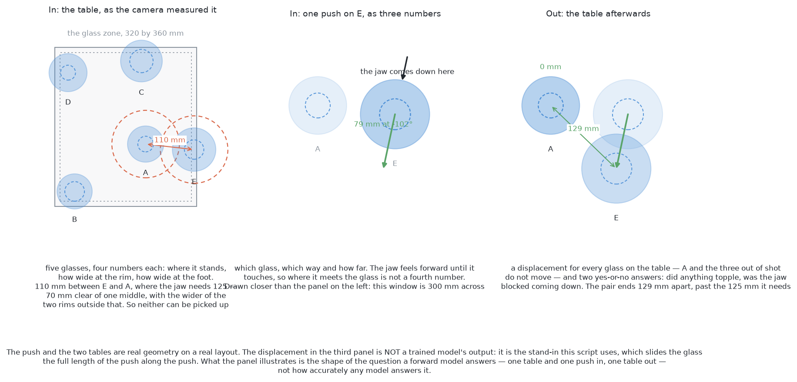

# What it is

> **What it uses** — PyTorch, and MuJoCo through [the test
> examiner](../01_the-problem/03_the-examiner.md). The model is a small network
> written for this cell and trained here. There are five copies of it, and no
> weights are downloaded from anybody. A second way, TD-MPC2, is described but
> **not built**, so no number on these pages belongs to it. [What it
> needs](05_what-it-needs.md) lists the libraries and their licences.
> **What it does** — it learns what a push does. Then it tries many candidate
> pushes against that learned model, not against the table, and makes only the
> best one. The model takes the table and one push, and it answers with the
> table afterwards.
> **How the output is produced** — `look()` gives one reading per glass. Each
> candidate push and the table become one row of 34 numbers, and all five
> copies of the model answer. Unsafe or doubtful candidates are dropped. The
> rest are scored by the room still missing afterwards. The best push goes to
> the examiner, which turns it into a path for the jaw.
> **What it costs** — pushes recorded in the simulator, which nobody has to
> label. Training takes about half an hour on a laptop processor. [What it
> needs](05_what-it-needs.md) gives the full bill.

> **The cell is described once, in [the cell](../../08_seeing-the-glasses/01_the-cell.md)**.
> That page shows the layout, the two camera positions, all four sensors, and
> the words this project uses for them. This chapter covers only what is
> specific to this solution.

## Contents

1. [Introduction](#1-introduction)
2. [A film of one table](#2-a-film-of-one-table)
3. [The problem this solves](#3-the-problem-this-solves)
4. [The main idea](#4-the-main-idea)

## 1. Introduction

This chapter explains one way to [push the glasses
apart](../01_the-problem/01_what-is-asked-for.md). The solution first learns
what a push does. Then it chooses each push by testing candidates against what
it learned, not against the table.

Every other solution here learns, or writes down, what to do. This one learns
what will happen, and works out what to do from that. The model answers with a
whole table. So the model can be asked again about the table it just returned.
This is what would let the solution plan a sequence of pushes. [Planning a
sequence](03_how-it-works.md#9-planning-a-sequence-which-only-this-solution-could-do)
explains this. The built planner looks only one push ahead.

By the end of this chapter you will know five things:

- what a forward model is, and how it differs from a policy;
- how a push is chosen by trying many candidates and refining the good ones,
  which is called the cross-entropy method;
- why a model that is a little wrong is still useful, if the arm looks again
  after every push;
- why the disagreement between five copies of a model measures what the model
  does not know;
- how the small model built here compares with TD-MPC2, a larger model that
  could be fetched instead.

First read [what goes in and what comes
out](../01_the-problem/02_what-goes-in-and-what-comes-out.md), because these
pages assume you know `look()` and `push()`. Also read [pushing without
toppling](../01_the-problem/05_pushing-without-toppling.md), because it states
the shared rule for refusing a glass.

Each numbered box is explained, one by one, on [the summary of this solution](../03_the-seven-solutions/05_a-world-model-then-plan-with-it.md).

The next section shows the method at work on one table.

## 2. A film of one table

The introduction described the method in words. This film shows it on one
table in the simulator, at one and a half times real speed.

[A learned world model planning on one table, 44 seconds and no sound](https://docs.dodao.io/videos/pushing-the-glasses-apart/04-a-world-model.mp4 "video")

The table holds six glasses. Five of them have no room at the start.

In the film, the arm racks all six glasses in **three pushes**, and nothing
falls over. The other five solutions leave this table unfinished or wrong. This
method needs few pushes because it can predict where a glass will stop. So it
can choose a push that finishes the job, instead of nudging and looking again.

This film shows one good table. Over all 50 test tables, the same planner
topples a glass on 19 of them. [Where it sits among the other
five](06_how-it-compares.md#3-where-it-sits-among-the-others) gives the
full score.

The six measured solutions are all filmed on this same table. [The six
films](../11_the-results.md#3-the-six-films-all-of-the-same-table) puts them
side by side and says how the table was chosen.

The next section says which problem a learned model of the table is meant to
solve.

## 3. The problem this solves

This section narrows [the problem](../01_the-problem/01_what-is-asked-for.md)
to the one difficulty this solution aims at.

The arm must push crowded glasses apart without knocking any over. [The target
layout](../01_the-problem/04_the-target-layout.md) already says where the
glasses should end up. What is left is the hard half: **what a given push will
really do**.

That half is hard because nothing in the cell measures friction. Whether a
glass slides or tips depends on friction, as [pushing without
toppling](../01_the-problem/05_pushing-without-toppling.md) explains. So a
solution that writes the rule down has to guess a number in it.

There are two ways out. The first is to guess carefully, push, look, and
correct. [One fixed nudge](../04_one-fixed-nudge/01_what-it-is.md) and
[geometry generates, a model
ranks](../05_geometry-generates-a-model-ranks/01_what-it-is.md) do this. The
second way is this solution's. **It never writes the rule down.** It pushes
glasses thousands of times in the simulator, records what happened, and fits a
function to the records. Friction is then not a number the solution holds. It
is a pattern in the recorded pushes. The model also learns other things nobody
wrote down. For example, the jaw meets a tapered glass at its top edge, and a
pushed glass turns as well as moves.

There is a second difficulty. A glass pushed out of one crowd can end up in
another. A glass pushed into a clear spot can block the path the next glass
needed. So choosing which glass to move, and in what order, needs the whole
table. Only a method that can say what the table will look like afterwards can
ask that question.

The next section gives the main idea that lets this solution ask what a push
will do.

## 4. The main idea

The problem above needs a way to predict pushes. The main idea is to keep two
things apart.

**The first thing is knowing what will happen.** One function answers one
question: given this table and this push, what is the table afterwards? This
function holds no opinion about which push is good.

**The second thing is deciding what is good.** This is plain arithmetic over
tables. A table where every glass has its 76 mm of clear room is good. A table
where a glass has fallen over is not acceptable. A shorter push is better than
a longer one.

A search connects the two. It proposes pushes, asks the model what each one
does, scores each answer with the arithmetic, and makes the best push.

The two halves come from different places. What will happen is a fact about
the world, so it has to be learned from pushes in the simulator. What is good
is a fact about the task, and [the
problem](../01_the-problem/01_what-is-asked-for.md) already writes it down.
Keeping them apart has one large benefit. **The same model can serve a new goal
by changing only the arithmetic.** For example, the task could change to
spreading the glasses evenly. The model would stay the same, and no training
would be needed. A trained policy would have to be trained again.

One part is missing from the built planner. [Pushing without
toppling](../01_the-problem/05_pushing-without-toppling.md) gives a shared rule.
It refuses a glass that would tip before it slides. That rule should run before
the search, but the built planner does not have it yet. The planner holds no
friction value and no tipping formula. So its only guard against a topple is the
model's own prediction. **This is a gap in the solution, not a second opinion.**

[The code](02_the-code.md) shows the model and the scoring as code.

← [Imitation from demonstrations — questions and answers](../06_imitation-from-demonstrations/07_questions-and-answers.md) · [The code](02_the-code.md) →
