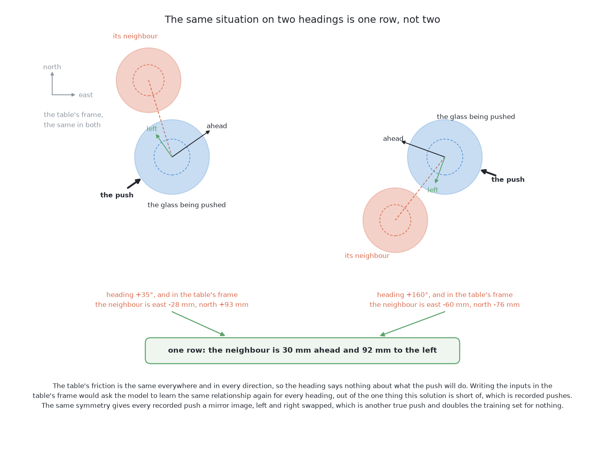
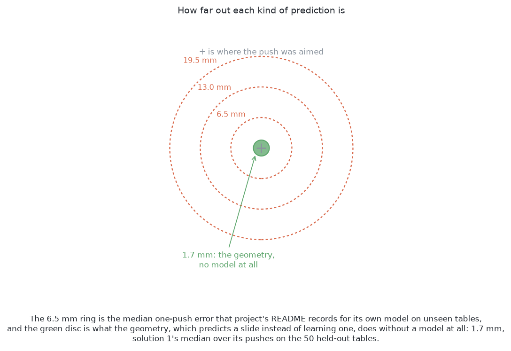

# How it works

This page explains what happens inside this solution, one part at a time. It
follows [the code](02_the-code.md), and it explains what each part of that code
is doing.

## Contents

1. [What exists in code, and what is a design](#1-what-exists-in-code-and-what-is-a-design)
2. [What a forward model is](#2-what-a-forward-model-is)
3. [What this model is shown, and what it answers](#3-what-this-model-is-shown-and-what-it-answers)
4. [The push's own frame, and why direction carries no information](#4-the-pushs-own-frame-and-why-direction-carries-no-information)
5. [Ensembles as a measure of ignorance](#5-ensembles-as-a-measure-of-ignorance)
6. [Planning by sampling: the cross-entropy method](#6-planning-by-sampling-the-cross-entropy-method)
7. [Receding horizon: plan several, make one](#7-receding-horizon-plan-several-make-one)
8. [Compounding error over a rollout](#8-compounding-error-over-a-rollout)
9. [Planning a sequence, which only this solution could do](#9-planning-a-sequence-which-only-this-solution-could-do)
10. [A second way — TD-MPC2 off the shelf](#10-a-second-way--td-mpc2-off-the-shelf)

## 1. What exists in code, and what is a design

Some parts of this solution are running code, and some are only described.
This section says which is which, before any of the ideas.

**The first way is built.** It is in
[`code/src/09_pushing-the-glasses-apart/04-a-world-model/`](https://github.com/RobinNagpal/robotics-basics/tree/main/code/src/09_pushing-the-glasses-apart/04-a-world-model).
It collects its own training data and trains on it. It was run on the
examiner's 50 test tables. Its results are in that folder's
[`results.json`](https://github.com/RobinNagpal/robotics-basics/blob/main/code/src/09_pushing-the-glasses-apart/04-a-world-model/results.json).
The model is
[`model.py`](https://github.com/RobinNagpal/robotics-basics/blob/main/code/src/09_pushing-the-glasses-apart/04-a-world-model/model.py).
What it is shown is
[`features.py`](https://github.com/RobinNagpal/robotics-basics/blob/main/code/src/09_pushing-the-glasses-apart/04-a-world-model/features.py).
The search and the loop are
[`plan.py`](https://github.com/RobinNagpal/robotics-basics/blob/main/code/src/09_pushing-the-glasses-apart/04-a-world-model/plan.py).
Everything this page says about those three files describes real code.

**Planning a sequence is a design.** The built planner chooses one push at a
time. It scores each candidate by the table one push later, makes the best
push, and looks again. It never asks the model about a second push. The model
could support a sequence, because its answer is a table. But the built planner
looks only one push ahead. [Compounding error over a
rollout](#8-compounding-error-over-a-rollout) says why.

**The second way is a design, and it claims nothing.** It is TD-MPC2. It has not
been connected to the examiner, trained or run here. So every number on these
pages belongs to the first way. [What it needs](05_what-it-needs.md) says where
TD-MPC2 would come from.

The next section starts with the object everything else rests on.

## 2. What a forward model is

The first way is built around one object, the forward model. This section says
what it is.

A **forward model** is a function from a situation and an action to the
situation afterwards. As a signature it is `(state, action) -> state`. It does
not know what the action was for. It does not prefer one result over another.
It cannot be asked what to do. It can only be asked what happens.

In programming terms, a forward model is a **pure function**. Given the same
inputs, it returns the same output, and it has no side effects. So **you can
call it as often as you like, and nothing breaks.** This is what makes it
possible to search against it. A real push can topple a glass. A call to the
model is only arithmetic. So a search that would be reckless on the real table
is safe on the model.

A pure function of this type also returns the same kind of thing it takes in.
So `(state, action) -> state` can be fed its own output. Give it the returned
state and a second action, and you get the state two actions later. **This is
what makes a sequence possible.** It comes from the shape of the function, not
from how well it was fitted.

A **policy** is different. It is a function from a situation to an action,
`state -> action`. It answers "what should I do?" in one step, with no search.
[Imitation from demonstrations](../06_imitation-from-demonstrations/01_what-it-is.md)
and the two SmolVLA solutions are policies. In short, a policy is fast and
narrow, and a forward model is slow and general.

The next section says what this forward model takes in and what it gives back.

## 3. What this model is shown, and what it answers

A forward model needs a state and an action. This section lists exactly what
the first way uses for them. The answer is what the arm has, and nothing else.

**34 numbers go in.**

- The table's kind of glass, as four yes-or-no columns, one per kind.
- The pushed glass's height, widest width and foot width. These are the three
  measurements `look()` gives, with the error measured in [telling the glasses
  apart](../../08_seeing-the-glasses/11_the-results.md).
- The push, as two numbers: how far across the glass the jaw meets it, and how
  far it pushes.
- Five slots for the other glasses, nearest first, with five numbers each. Two
  numbers say where the glass stands from the pushed glass. The others give its
  width, its height, and whether there is a glass in that slot at all. A table
  has at most six glasses, so five slots hold everyone. Spare slots stay empty.

**14 numbers come out.**

- The movement of the pushed glass.
- The movement of each of the five other glasses. A push moves neighbours too,
  and a model that predicted only its target would miss that.
- Two yes-or-no answers: did anything topple, and was the jaw blocked on the
  way down?

Three points about these lists matter.

**The model gets only what the arm has.** It gets no friction, no mass and no
tipping rule. If the model learns when a glass tips, it learns it from the data.

**The two yes-or-no answers matter most.** A movement that is a few millimetres
wrong costs one more push. A topple that was not predicted costs a glass, and
nothing here can stand a glass up again. So the model is mainly a safety check.
Topples are rare in the data. A model trained on rare events can learn to
answer "no" every time and still be right almost always. So training gives the
topple examples more weight, until both sides count the same.

**The answers come from the camera, not from the simulator.** Each answer is
the difference between two looks, one before and one after the push. [What it
needs](05_what-it-needs.md#1-what-it-needs) explains why this is the right
choice.

The next section looks at one choice inside those 34 numbers: the directions
they are measured in.

## 4. The push's own frame, and why direction carries no information

The list above gives positions and movements. This section says which
directions they are measured in, because a good choice here makes the problem
smaller.

Every position in the inputs, and every movement in the outputs, is measured
**in the push's own frame**. One number is along the way the jaw moves. The
other is across, to its left. Nothing is measured as north and east on the
table.

This means **a push to the north and the same push to the east are one example,
not two**. Say a neighbour is 30 mm ahead of the pushed glass and 92 mm to its
left. That is the same input row, whichever way the jaw points. So the model
sees one situation, which is what it really is.

This works because of a fact about the cell. **The table's friction is the same
everywhere and in every direction.** There is no slope and no sticky patch. So
the direction of a push says nothing about what the push will do. If the
direction were an input, the model would have to learn the same thing again for
every heading. That would waste recorded pushes, which are this solution's most
costly resource.

There is a second benefit. A push and its mirror image, with left and right
swapped, are both real pushes. So every recorded push can be used twice: once
as it happened, and once mirrored. This doubles the training set with real
examples.

The frame has a limit. **It removes only the information that does not
matter.** The arm's reach and the edges of the glass zone are not the same in
every direction, and the model knows nothing about either. So the map of where a
glass may stand and where the arm can reach stays as written arithmetic. It is
checked against the model's predicted table, and it is not learned.

The next section turns to the hardest question for any trained model: how does
it show that it does not know?

## 5. Ensembles as a measure of ignorance

The model now gives answers. This section explains how the solution also learns
when an answer cannot be trusted. It is the most useful idea in this chapter.

A plain network always answers. Show it a push unlike anything in its training
data, and it answers with the same confidence as for a push it has seen many
times. This is a real problem for a planner, because **a search works against
its own model**. The search tries hundreds of candidates and keeps the one the
model likes best. So it finds exactly the places where the model is wrong in a
helpful-looking way. A model that is right on average but badly wrong in a few
places will have those places chosen for it.

The fix is simple. **Train the same network several times, from different
random starting weights, on the same data, and keep all the copies.** The first
way keeps five. Where the five agree, the training data fixed the answer. This
means the model has seen pushes like this one. Where they disagree, the data did
not fix the answer. Each copy then filled the gap in its own way. So **the
spread between the copies measures what the data did not say.** It costs only
the training of four more small networks.

The planner uses that spread in two different ways. For the movements, it takes
the average of the copies. Here the spread only affects accuracy, and the next
look corrects it. For toppling, it takes **the worst copy's chance, not the
average.** If any one of the five thinks a push might tip a glass, the push
carries that copy's number. So a push gets through only when all five agree it
is safe. The limit is one in a hundred. If any copy gives a push more than a 1%
chance of a topple, the push is dropped.

The two rules differ because the two mistakes cost different amounts. Refusing
a push that would have been fine costs a refusal, and the examiner counts a
refusal as a result. Making a push that tips a glass costs the glass for good.

The search's pressure is answered a second time. A search over thousands of
candidates can find a push that looks safe only because of a lucky millimetre
in the readings. So every candidate is also checked on four copies of the
table. In each copy, every position is moved by about a millimetre and every
width by about three. The worst topple chance over all five readings is the one
that counts. **A weak spot in the model narrow enough to be found by luck does
not survive a one-millimetre shift.** A really safe push does.

Five copies trained on the same data can still all be wrong in the same way.
[Where it is strong and where it
breaks](06_how-it-compares.md#1-where-it-is-strong-and-where-it-breaks) shows
this.

The model can now answer and can show doubt. The next section explains how the
solution uses it to find a good push.

## 6. Planning by sampling: the cross-entropy method

The model and its doubt are in place. This section explains how the solution
finds a good push with them. The answer is simple: try a lot of pushes.

A candidate push here is three numbers. They are the direction the jaw points,
where across the glass it meets the glass, and how far it travels.
**Sampling** means drawing many candidates at random from the allowed range.
Each one goes to the model, each predicted table is scored, and the best is
kept. This alone is called random shooting, and it already works. But it spends
most of its draws in parts of the range that the first round already ruled out.

The **cross-entropy method** adds one step: use the good draws to decide where
to draw next. It runs in rounds.

1. Draw a batch spread over the whole allowed range.
2. Score every draw.
3. Keep the best few. These are called the elite.
4. Work out the average and the spread of the elite.
5. Draw the next batch around that average, with that spread.
6. Repeat.

Each round, the cloud of candidates shrinks toward the region that keeps
scoring well. So the later draws are spent near the answer.

The first way draws 600 candidates in the first round and 300 in each of three
more rounds. It keeps the best 30 each time. **This is 1,500 candidate pushes
for each crowded glass.** That sounds like a lot, but it is cheap. Each
candidate is one row of 34 numbers, and each network takes a whole round's rows
in one call. [What it needs](05_what-it-needs.md#1-what-it-needs) gives the
measured time per push.

Two properties make this the right search here.

**It needs no gradients.** A gradient says how the score changes when a push
changes by a tiny amount. This method never asks that. It only asks which
candidate scored better. So the score does not need to be smooth or
differentiable. The map test, the reach test and the topple veto are all plain
yes-or-no conditions, and that is fine.

**It handles a cost with sudden jumps.** A push that topples a glass is not a
little worse than one that does not. It is not acceptable at all. A method that
walks downhill needs a smooth slope. This method needs only a comparison. So a
cost of infinity for a bad candidate is an ordinary value for it. Many rules in
this problem are hard limits, so this property decides the choice.

The score is plain arithmetic over the predicted table:

- Add up, over every glass, how much clear room is still missing. This is how
  far each neighbour's edge reaches inside the 76 mm that the glass needs.
- Add a tenth of a millimetre for every millimetre the jaw travels. So the
  shortest push that does the job wins.
- The model also gives the chance that the jaw is blocked on the way down. A
  blocked push moves nothing. So the score mixes two tables by that chance: the
  table as it is now, and the predicted table.

Three filters drop a candidate before it is scored:

- any copy of the model gives it more than the topple limit;
- the predicted table puts a moved glass outside the glass zone, or the jaw
  outside the arm's reach;
- the predicted movement is more than two centimetres longer than the push.
  This means the model is answering about something it has not seen.

The best surviving push over all the crowded glasses is the one made.

The search returns one push. The next section asks why the arm should not plan
several pushes and make them all.

## 7. Receding horizon: plan several, make one

The search above returns one push. It is tempting to plan several pushes and
make them all in order. This section explains why that is a mistake.

**Receding horizon** means this: plan several steps ahead, make only the first,
then throw the rest away and plan again from a new look. The end of the plan
keeps moving forward as the arm moves, which is where the name comes from.

This suits a model that is a little wrong. A plan several steps deep is built
on the model's guesses about tables the arm has not seen. If the arm made every
step, each step would act on a table a little further from the truth. Nothing
would notice. If the arm makes only the first step and then **looks**, a
measurement replaces the guess. Whatever the model got wrong is thrown away. So
only one push of the plan could ever have been wrong.

[Pushing without toppling](../01_the-problem/05_pushing-without-toppling.md)
describes this as a loop that reads its state again on every pass. Here the
state is the table, and `look()` reads it.

This is also why a model that is only fairly good is enough. The model must
**rank the pushes available now**. It does not have to describe the future
exactly. It can be several millimetres out about where a glass lands and still
pick the better of two pushes. The next look corrects those millimetres.

The receding horizon limits the damage of a wrong plan. The next section
explains why plans that reach further are more often wrong.

## 8. Compounding error over a rollout

The receding horizon limits the damage of a wrong plan. It does not make the
plan right. This section explains why a plan gets worse the further it reaches.

A **rollout** means feeding the model's own output back into it. Feed in its
predicted table with a second push, and you get the table two pushes later.
Each call adds its own error. Also, **each call starts from a table that the
call before got slightly wrong.** So the errors do not just add up. They grow.
A model asked about a table unlike its training data answers worse. That gives a
table even further from its training data, which it answers worse again.

The numbers show the size of this. The project's
[`README.md`](https://github.com/RobinNagpal/robot-arm-projects/blob/main/v5-pick-glasses/03-push-glasses-apart/04-a-world-model/README.md)
for the first way records the model's error on 628 pushes from tables it never
trained on. The median error for where a pushed glass lands is 6.5 mm. That is
a useful one-step model. If the error only added up, a plan three pushes deep
would be about 19.5 mm out. The gaps this problem depends on are tens of
millimetres. And the real error grows faster than that simple sum. **So a model
that is good at one step can be useless at five.**

The picture below draws three sizes as rings around the point a push aimed at.
The inner ring is the model's one-step error. The two outer rings are the simple
sum after two pushes and after three. The small green disc in the middle is the
error of the geometry, which predicts a slide by arithmetic instead of learning
it. On the 50 test tables, [one fixed
nudge](../04_one-fixed-nudge/01_what-it-is.md) landed its pushed glass 1.7 mm
from its aim at the median, in its
[`results.json`](https://github.com/RobinNagpal/robotics-basics/blob/main/code/src/09_pushing-the-glasses-apart/01-one-fixed-nudge/results.json).

These millimetres matter because the gaps are small. A push may aim to leave
only a few millimetres more than the jaw needs. A miss of 6.5 mm in the wrong
direction then leaves the glass short of room. The next look has to catch it.

This is why the built planner looks only one push ahead. Every training example
is a single push. So the model was never asked to be right about a table that
its own prediction made.

**The fix is to train on rollouts of several steps, not only single steps.**
Start from a measured table and roll the model forward several pushes. Then
score it on how well the whole sequence matches what really happened. The fit
is then punished for predictions that drift after two steps. So it learns to
make tables that it can itself handle as input. This is the standard fix, and
the second way does it by design. That is one of the clearest reasons to want
the second way.

The first way uses two cheaper habits. First, **keep the plan as short as the
task allows**, because the error grows with depth. Second, **collect training
data from the planner itself**, not only from random pushes. The first way's
second round of data does this. The first model plans, and the planner finds
the pushes where that model is wrong in its own favour. Those pushes are really
made, and what happened goes into the training set. This fills exactly the gaps
the search would use. A quarter of that round is still random. So the model
keeps seeing pushes the planner would never choose.

The error sets a limit on depth. The next section shows what a short sequence
can still do.

## 9. Planning a sequence, which only this solution could do

The sections above are machinery. This section shows what the machinery could
do that no other solution here can.

Take a table where glass A is crowded and has nowhere to go. Every direction
runs into glass B, leaves the glass zone, or takes A out of the arm's reach. A
solution that judges each push by the table one push later will refuse. It
will say that no push helps. But it is wrong, because the answer is to push B
first. Moving B does not make any glass grippable. It opens the path that A
needed.

**A push whose only value is what it lets the next push do** cannot be seen by
a method that scores pushes one at a time. On its own, such a push clears no
room and costs a push. Only a method that can ask "and then what?" can see its
value. To ask "and then what?", you need a function that returns a table. **This
solution's model returns a table, so its answer can be fed back in as the next
question.** No other solution here has that.

The change to the built planner is small, and the model does not change at all.

- The search now draws three numbers per candidate. A two-push search would
  draw six: a first push and a second.
- It would run both pushes through the model in turn and score the table at
  the end.
- The topple veto would apply at every step. So a sequence that topples a glass
  halfway is dropped, whatever comes after.
- Only the first push of the best pair would be made. Then the arm looks again,
  as the receding horizon says.

What changes is how many times the model is called. The cost of the search
grows fast with depth. So the planner should use the shortest plan that finds
the answer.

Two limits apply.

**Only a small depth is useful.** Compounding error limits how far a rollout
can be trusted, and for the first way's model that limit is low. Two pushes is
reasonable. Three is hopeful. Anything deeper is guessing.

**On this examiner, a sequence mostly saves pushes.** A table where a
one-at-a-time planner must refuse and a two-push planner succeeds is rare with
four to six glasses. The usual gain is finishing the same table in fewer
pushes. That matters here for one reason. **Touching a glass is the only step
that can topple one.** So four pushes instead of six means two fewer chances of
the one failure that cannot be undone.

The model in this chapter is written by hand. The next section describes a
model that could be fetched instead.

## 10. A second way — TD-MPC2 off the shelf

The first way's model is written here. This section describes a second way:
use a model that somebody else maintains.

**TD-MPC2** has the same shape. It learns what happens, searches over actions
against what it learned, and makes only the first action. It differs in what
its model predicts.

The model written here predicts the next table directly. It uses the quantities
the arm measures, so every number has a name and a unit a person can check.
TD-MPC2 turns the situation into a list of numbers of its own choosing. Those
numbers mean nothing to a person. It learns how that list changes under an
action, and it plans there. It never turns the list back into positions and
widths.

So the two ways trade against each other:

- The hand-built model can be read, and it trains in minutes on an ordinary
  processor.
- TD-MPC2 is stronger, and it is trained on rollouts of several steps by
  design. It is also kept up to date by people who do this as their job. But it
  cannot be read, and it needs an accelerator.

**It is not built, so it has no score.** Comparing the two would show whether
building the model by hand was worth it. Suppose a maintained model clears
tables no better than five small networks trained in half an hour on a laptop.
Then the cell is narrow enough that the hand-built model was the right choice.

The next page follows the first way through real tables.

← [The code](02_the-code.md) · [A worked example](04_a-worked-example.md) →
