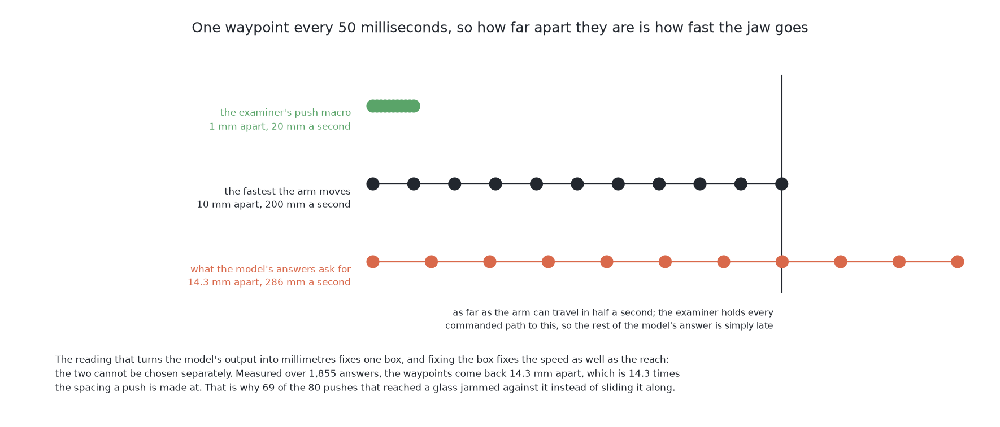

# The code

This page shows the main code of this solution. It also says what the solution
hands back to the rest of the cell. [How it works](03_how-it-works.md) explains
what the code is doing, part by part.

## Contents

1. [The code that does the work](#1-the-code-that-does-the-work)
2. [The pushes are what this contributes](#2-the-pushes-are-what-this-contributes)
3. [How the concepts fit together](#3-how-the-concepts-fit-together)

## 1. The code that does the work

Nothing here is fitted. So the only code this project wrote is the join between
the model's output and this cell's jaw. The model's actions come out with no
units. [How it
works](03_how-it-works.md#4-the-actions-arrive-with-no-units-in-them) explains
why. So a scale had to be chosen, not converted.

The library does its work in one call, in
[`05-smolvla-as-it-downloads/policy.py`](https://github.com/RobinNagpal/robotics-basics/blob/main/code/src/09_pushing-the-glasses-apart/05-smolvla-as-it-downloads/policy.py).
`predict_action_chunk` comes from LeRobot. `self.pre` and `self.post` are the
processors that ship with the model, and here they do nothing. `to_jaw` is this
project's own code.

That call runs in four steps.

1. Build the model's input. This is the top-down picture, with the colour
   channels first and values from 0 to 1. It also includes the jaw's pose, and
   the instruction, which is the same sentence every time.
2. Run the model once. It returns 50 actions.
3. Divide every action by `ACTION_SPAN`, and cut off anything past the limit.
   This makes two standard deviations of output reach the edge of the picture's
   frame, and nothing goes past it.
4. Read the four slots that matter. Two give a position on the table, measured
   from the centre of the frame. One gives a height between the pushing height
   and the travel height. One gives a heading.

Steps 1 and 2 are in [`policy.py`](https://github.com/RobinNagpal/robotics-basics/blob/main/code/src/09_pushing-the-glasses-apart/05-smolvla-as-it-downloads/policy.py). Steps 3 and 4 are the whole of `to_jaw`.

```python
    def ask(self, picture: np.ndarray, jaw: Waypoint) -> np.ndarray:
        ...
        batch = {
            # Step 1: the picture, as the model takes it -- colour first, and 0 to 1 not 0 to 255
            CAMERA: torch.from_numpy(picture.copy()).permute(2, 0, 1).float() / 255.0,
            # Step 1: where the jaw is standing -- the model answers in these same units
            "observation.state": torch.from_numpy(to_state(jaw, self.up)).float(),
            # Step 1: the instruction -- the same sentence on every table and every push
            "task": INSTRUCTION,
        }
        # Step 2: one pass through the borrowed model -- it draws 50 actions from fresh noise
        with torch.no_grad():
            actions = self.policy.predict_action_chunk(self.pre(batch))
        # Step 3: read those 50 actions as waypoints for this jaw -- joining.py sets the scale
        return to_jaw(self.post(actions)[0].numpy().astype(float), self.up)
```

The scale that `to_jaw` uses is in
[`05-smolvla-as-it-downloads/joining.py`](https://github.com/RobinNagpal/robotics-basics/blob/main/code/src/09_pushing-the-glasses-apart/05-smolvla-as-it-downloads/joining.py).
The whole choice is one constant, which is step 3, and four lines that use it,
which is step 4. There is one line for each slot the cell can use. The model has
six slots, and the other two are dropped. This is because this cell keeps the
jaw level and closed, so it cannot change either.

```python
# Which of SmolVLA's six slots carries what, in the reading above.
ACROSS, OUT, UP, TURN = 0, 1, 2, 4

...

# How many standard deviations of the model's own action space the picture's
# frame covers. Two, because a z-score of two is the edge of what a normally
# spread quantity does, so the whole frame is reachable without the great
# majority of the model's output pinning itself against the edges.
ACTION_SPAN = 2.0

...

def to_jaw(action: np.ndarray, up: float = UP_HIGHER) -> np.ndarray:
    ...
    # Step 3: divide by ACTION_SPAN and clip -- two standard deviations become the frame's edge
    unit = np.clip(action / ACTION_SPAN, -1.0, 1.0)
    return np.stack(
        [
            # Step 4: the across slot sets the position across the table -- from the frame's centre
            VIEW_CENTRE[0] + unit[:, ACROSS] * TOP_VIEW_HALF_FRAME,
            # Step 4: the out slot sets the position out from the arm -- the frame's other axis
            VIEW_CENTRE[1] + unit[:, OUT] * TOP_VIEW_HALF_FRAME,
            # Step 4: the up slot sets the height -- between the pushing and the travel height
            PUSH_HEIGHT + (up * unit[:, UP] + 1.0) / 2.0 * (TRAVEL_HEIGHT - PUSH_HEIGHT),
            # Step 4: the turn slot sets the heading -- a half turn either way, in radians
            unit[:, TURN] * math.pi,
        ],
        axis=1,
    )
```

The model can see only one thing that has a size in millimetres: the frame of
the top-down picture, which is 727 mm across. So `ACTION_SPAN = 2.0` means that
two standard deviations of output cover that frame. This makes one standard
deviation equal to 182 mm across the table and 56 mm of height. With this
choice, the model can put the jaw anywhere it can see, and nowhere it cannot.
A join needs that property, so that the score measures the model and not the
join. [Solution 7](../10_a-newer-larger-model-fine-tuned-here/01_what-it-is.md) imports this same
[`joining.py`](https://github.com/RobinNagpal/robotics-basics/blob/main/code/src/09_pushing-the-glasses-apart/05-smolvla-as-it-downloads/joining.py)
and the loop in
[`clear.py`](https://github.com/RobinNagpal/robotics-basics/blob/main/code/src/09_pushing-the-glasses-apart/05-smolvla-as-it-downloads/clear.py).
So its model's actions are read in
exactly the same way.

This choice has a cost that is easy to miss. The examiner uses one waypoint
every 50 milliseconds. So **the distance between waypoints sets how fast the
jaw is asked to move**. Fixing the frame fixes the speed as well as the reach.
The two cannot be chosen separately. Measured, the model's waypoints come back
14.6 mm apart. That asks for more than the arm's top speed. It is also fourteen
times the speed of the examiner's push macro.



This solution does not slow that down to a gentler speed. A gentler limit would
be a number chosen to make the solution look better, and this solution fits
nothing. The examiner does hold every path to the fastest speed the cell ever
moves the jaw. That limit belongs to the arm, and it applies to all seven
solutions.

The code turns the model's answer into jaw waypoints. The next section says
where this solution's work stops and the examiner's begins.

## 2. The pushes are what this contributes

The last section showed what the code produces. This section says where the
solution stops, because that boundary is the same for all seven solutions and
makes them comparable.

[The examiner](../01_the-problem/02_what-goes-in-and-what-comes-out.md#3-what-look-hands-over)
fixes the input. This solution may read what `look()` returns and the top-down
picture. In practice it reads mostly the picture, because that is what the
model takes. It may not read the simulator's record of the table, and it is
not told the friction. A borrowed model gets no exception.

The output is fixed too: **a jaw trajectory**. This solution gives one
directly, as 50 waypoints. It does not use the examiner's push macro. The
examiner accepts both forms, because **it scores the table afterwards, not the
push**.

This changes how one column of the scores should be read. The examiner records
how far a pushed glass ended from where the solution aimed it. Most other
solutions give that aim as a prediction. This model is never asked where a
glass should end up. So the aim is taken as the end of the path. The median
distance of 71.5 mm is therefore the distance from the end of a path to the
glass it moved. It is a different quantity from solution 1's 1.7 mm, so it is
not a failed prediction.

One thing about repeated runs is special here. The examiner asks for several
runs, because one run is not a measurement. **This solution has no training
seed**, because it trains nothing. Its only variation comes from the model
drawing each answer from fresh noise. So its spread should be smaller than
solution 6's, and it is. Over three runs it racked 48, 51 and 46 glasses, a
standard deviation of 2.5. Solution 6 has 7.6 on the same count.

The boundary is now clear. The next section puts all the pieces of this
solution together into one picture.

## 3. How the concepts fit together

The last two sections showed the code and its limits. This section joins them
into one short picture, because the solution is short.

A model trained on a huge pool of real robot data is downloaded unchanged. It is
shown the top-down picture, one fixed sentence and the jaw's pose. It returns 50
actions. Somebody has to read them as waypoints for this jaw, because they have
no units. The examiner carries them out, the table changes, and the model is
asked again.

The model brings a general sense of how handling objects goes. It knows nothing
about this cell. It never gets the force reading, because it has no input for
force. And [the domain
gap](03_how-it-works.md#7-the-domain-gap-which-is-the-heart-of-this-document)
between its training pictures and these drawn ones is large. So it gives
movement that does not fit this table.

All of this follows from one decision: **fit nothing here**. That decision makes
the solution free to try. It also removes every way to fix the problems above.
[Solution 6](../09_the-same-model-fine-tuned-here/01_what-it-is.md) uses
exactly one of those ways.

← [What it is](01_what-it-is.md) · [How it works](03_how-it-works.md) →
