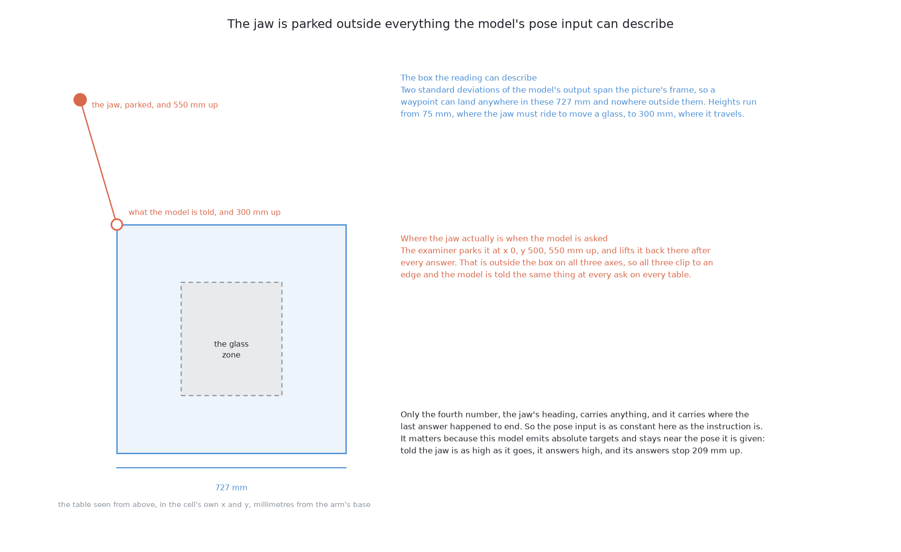

# How it works

This page explains what happens inside this solution, part by part. It follows
[what it is](01_what-it-is.md), which states the question and the one idea
behind the solution. This page is also the main home of the facts about the
borrowed model, SmolVLA. The chapter on [the same model fine-tuned
here](../09_the-same-model-fine-tuned-here/01_what-it-is.md) uses them too.

## Contents

1. [A model that sees, is told, and acts](#1-a-model-that-sees-is-told-and-acts)
2. [Where such a model gets its competence](#2-where-such-a-model-gets-its-competence)
3. [What is borrowed, and what is not](#3-what-is-borrowed-and-what-is-not)
4. [The actions arrive with no units in them](#4-the-actions-arrive-with-no-units-in-them)
5. [Two of the three inputs say the same thing every time](#5-two-of-the-three-inputs-say-the-same-thing-every-time)
6. [The force reading has nowhere to go](#6-the-force-reading-has-nowhere-to-go)
7. [The domain gap, which is the heart of this document](#7-the-domain-gap-which-is-the-heart-of-this-document)
8. [What was expected, and what happened](#8-what-was-expected-and-what-happened)
9. [The price of the model, and why this model](#9-the-price-of-the-model-and-why-this-model)

## 1. A model that sees, is told, and acts

The rest of this page depends on what goes into the model and what comes out.
So this section explains that first.

Three things go in together:

- **a picture** from the camera;
- **an instruction in ordinary words**, such as "pick up the red block";
- **the robot's joint readings**, which say where each joint is now.

One thing comes out: **robot actions**. These are targets for the robot to move
to, one after another. SmolVLA returns 50 of them at a time. So one answer is a
short run of movement, not a single pose.

A model with these three inputs and this output is called a
**vision-language-action model**. The name lists the three parts in order. The
model takes the raw picture and the sentence, and it gives back movement. No
code written by a person sits between the two.

This is different from the other learned solutions in this book. In solution 4,
the learned part predicts how the table changes, and a separate search makes the
choice. In solution 2, hand-written geometry proposes pushes, and the learned
part only ranks them. Here one network does the whole job. So one downloaded
file can be a complete answer. It also means there is no small part to fix when
the answer is wrong.

A model that knows nothing about this cell is only worth trying if it knows
something general. The next section says where that general knowledge comes
from.

## 2. Where such a model gets its competence

The model has never seen this cell, so its skill must come from somewhere else.
This section says where.

It comes from **pretraining**. This means the model was first trained on a very
large set of recorded demonstrations, from many robots doing many tasks. In each
recording, a person drove a robot arm to reach, grasp, move or put down things.
The picture, the instruction and the joint readings were recorded together.
SmolVLA was trained on **487 community datasets of real teleoperation**.
Teleoperation means a person drives the robot by remote control. So the data
shows real robots in real rooms.

From data like that, a model does not learn any one task. It learns the general
shape of handling objects. For example, an arm slows down as it reaches an
object. A gripper closes only when it is on the object. A push is a touch
followed by movement in one direction.

**So the model knows how handling objects usually goes, and it knows nothing
about this cell.** It does not know where the glass zone is. It does not know
how far the arm can reach. It does not know that a glass pushed too high tips
over. Those facts are written down in [the
cell](../../08_seeing-the-glasses/01_the-cell.md) and [the
problem](../01_the-problem/01_what-is-asked-for.md). A model trained elsewhere
has never met them.

That split between general skill and local facts is the core of this solution.
The next section states exactly which side of it each part falls on.

## 3. What is borrowed, and what is not

The last section showed that the model's skill is general. This section lists
what is taken from others and what is not, because that list makes this
solution a clean baseline.

**Nothing at all is fitted here.** The weights are downloaded and used
unchanged. There is no training run and no fine-tuning. No threshold is tuned on
the examiner's training tables. Every number in the model came from somebody
else's robots.

So the model has never seen this cell. It has never seen these four kinds of
glass. It has never seen this jaw, which is two closed fingers turned on their
side, 63 mm tall. It has never seen a table drawn the way this examiner draws
one.

Everything else is borrowed: the design of the network, the weights, and the
rules for reading pictures, reading words and writing actions. Other people
fixed all of these for their own robots.

That trade causes problems in three places. The next three sections take them
one at a time, starting with the output.

## 4. The actions arrive with no units in them

The first problem is at the output. The model's numbers do not say what
distance they stand for.

The first guess was a translation job. The model was trained on other robots,
so its actions should be in those robots' units. This cell's arm is a UR5e with
a two-finger gripper. So somebody would convert the numbers.

**In fact the released model gives numbers with no units at all.**
`lerobot/smolvla_base` has six action slots and six state slots. Each slot is
scaled by a mean and a spread. The model ships these statistics for SO-100 arm
joint angles, in degrees. But it saves them under names such as
`so100.buffer.action.mean`. LeRobot's normaliser looks for the names `action`
and `observation.state`. It does not find them, so it does nothing. This means
the state goes in as a z-score, and the actions come out as z-scores. A z-score
says how many standard deviations a value is from the mean. Nothing says what
one standard deviation is in millimetres.

So the scale had to be **chosen**, because there was nothing to convert from.
[`joining.py`](../../../code/src/09_pushing-the-glasses-apart/05-smolvla-as-it-downloads/joining.py)
makes that choice and explains it. [The code](02_the-code.md) shows the four
lines that use it.

A bad scale would make the model look worse than it is. The result would then
measure the scale, not the model. So **solutions 5 and 6 use the same scale**.
The pair stays clean only while everything except the training is the same.

The examiner was built to allow this step. [The
examiner](../01_the-problem/02_what-goes-in-and-what-comes-out.md#6-what-must-come-out)
accepts a run of waypoints directly, without the push macro. So a model that
thinks in movement does not have to squeeze its answer into three numbers.

The output needed a chosen scale. The next section turns to the inputs, where
the same scale causes a second problem.

## 5. Two of the three inputs say the same thing every time

The second problem is at the input. [A model that sees, is told, and
acts](#1-a-model-that-sees-is-told-and-acts) listed three inputs. In this
problem two of them never change. The first was expected. The second was not.

**The instruction never changes.** A model like this takes words so that one
set of weights can do many tasks. The sentence says which task to do. This
problem has only one task, so the sentence is the same on every push. An input
that never changes tells the model nothing. So the language part of the model
does no work here.

**The pose never changes either, and this was not expected.** The cause is the
cell, not the model. The chosen scale lets the model describe one box. The box
is the frame of the top-down picture, 717 mm across the table. Its heights run
from 75 mm, where the jaw must be to move a glass, up to 300 mm, where the jaw
travels. Between actions, the examiner parks the jaw 500 mm along the table from
the frame and 550 mm up. That spot is outside the box on all three axes. So all
three values are cut back to the edge of the box. This means the model is told
the same thing every time: the jaw is in the far corner, as high as it goes.
Only the heading changes.

This explains part of the result. SmolVLA gives target positions that stay near
the state it is given. So when it is told the jaw is high, it answers high. The
code folder measured this. The same picture was asked six times. With the parked
pose, the lowest point of an answer had a median of 182 mm. With a pose of all
zeros, it was 122 mm. So the parked pose raises the answers by about 60 mm. That
is not the whole story, because 122 mm is still far above the 75 mm the jaw
needs.

Two things follow from both inputs being constant.

First, the model is used here as **an expensive visuomotor policy**. That is a
program that looks at a picture and gives movement. Solution 3 fits exactly
that, with a much smaller network and nothing borrowed. So the extra size here
buys only the pretraining, and nothing to do with language.

Second, a bad score here does not show that vision-language-action models are a
poor idea. It shows only that one such model scores badly in this setting: one
fixed sentence, one fixed pose, drawn pictures and nothing fitted. This problem
never uses the language part, so it cannot test it.

Two inputs carry nothing. The next section is about an input this problem does
have, but which the model cannot take.

## 6. The force reading has nowhere to go

The third problem is a mismatch. The examiner offers something that the model
has no way to accept.

[The
examiner](../01_the-problem/02_what-goes-in-and-what-comes-out.md#why-the-force-reading-matters)
explains why the force reading is its most useful report. Friction is never
told to any solution, and nothing measures it. The force reading is the only
evidence of friction.

**This model has three inputs, and force is not one of them.** It takes a
picture, a sentence and a pose. The jaw's report of what it felt during a push
has no place to go in. The examiner still makes that report, but this solution
cannot use it.

The solution is not fully blind. The arm looks again after every push, so the
next picture shows where the glasses ended up. But it loses what happened during
the push. That is the part that tells a glass that slid from a glass that leaned
and settled back. And the model learns nothing anyway. It only sees the new
picture and answers again.

This also shows the limit of solution 6. More training cannot add an input
slot. It can only fit the model to this examiner's friction as a fixed value
inside the weights. [Solution
6](../09_the-same-model-fine-tuned-here/01_what-it-is.md) explains why that is
a risk away from this examiner, not a fix.

All three problems so far assume the model can read the pictures at all. The
next section tests that assumption, and it is the one that failed.

## 7. The domain gap, which is the heart of this document

The sections above assume the model works on this examiner's pictures. That
assumption failed. This section explains why, and it is the longest section
because the gap is large.

A **domain gap** is the difference between the data a model was trained on and
the data it is used on. Here the two sides are easy to describe.

**The model was trained on real teleoperation.** It saw 487 community datasets
of real robots in real rooms. So it saw real cameras, with noise, blur and real
colour. It saw real light, with shadows where an object meets a surface. It saw
busy scenes, with other objects, a room behind, and texture everywhere.

**This examiner shows it a drawn top-down picture of pale blue glasses on a tan
table.** The glasses are stacks of cylinders. The table is a flat rectangle, and
nothing else is in the frame. No lens made the picture. Every glass has the same
colour. There is almost no texture. And there is no transparency, which in a
real photo is the strongest sign of a glass.

So the model is asked about pictures very unlike the ones it learned from. Much
of the evidence it learned to use is missing.

**Models usually fail across such a gap without giving nonsense.** Nonsense
would be easy to spot and refuse. Instead, they usually give confident, sensible
looking, wrong actions. For example, a push that looks like a push, aimed at a
reasonable place, but not the push this table needed. That is the failure this
page was written to expect.

One point holds whatever the failure is. A push in the wrong place can be
recovered, because the arm looks again and starts from where the glasses really
are. A toppled glass cannot be recovered, because nothing stands a glass up
again. That is why the topple limit is kept out of the model's hands. [A worked
example](04_a-worked-example.md) shows that check.

This section said what kind of failure to expect. The next section says what was
measured, and it was different.

## 8. What was expected, and what happened

The last section predicted the failure from the domain gap. This section
compares that prediction with the measured runs.

The prediction was this. The model would give well-formed movement, because
pretraining teaches that even without knowing the scene. Sometimes it would give
a sensible push. Often it would pick the wrong glass, the wrong direction or the
wrong distance, because choosing well needs the picture to be read correctly.

**The measured failure is simpler and easier to see.** The examiner ran three
runs of the 50 held-out tables. Over them the model was asked 1,855 times. The
median run made 620 pushes, and **506 of them never touched anything.** The
reason is height. The median answer's lowest point is 217 mm above the table.
The jaw must be at 75 mm to move a glass, and these glasses are 90 to 230 mm
tall. So the jaw sweeps through the air above them. The same answer also travels
868 mm across the table in its 50 steps. That is wider than the picture's frame,
so the movement is large as well as high.

In that run, 114 pushes touched something, and 79 of them jammed. The cause is
speed. The waypoints come back 14.6 mm apart, which asks for more than the arm's
top speed. [The code](02_the-code.md#1-the-code-that-does-the-work) explains
why spacing means speed. A jaw that reaches a glass that fast wedges against it
instead of sliding it. That is where the toppled glasses come from.

So the prediction was wrong in an important way. The model does not choose
badly among pushes. Mostly it does not reach the table, and when it does, it
moves too fast. The domain gap is still the cause, because the pictures are
nothing like the model's own. Only the guess about how the gap would show was
wrong.

This failure is also easy to notice. The examiner counts every push that touched
nothing, and the count is in the results file. So a reader of the scores can see
at once that the problem is not aim.

**This solution's job is to be a baseline, not to score well.** Solution 6 uses
the same library, the same weights and the same examiner. The only change is
more training on this cell's own pushes. A low score here gives that comparison
room to show a difference.

The result is clear. The last question is what the model costs to run, and why
this model was chosen over a larger one.

## 9. The price of the model, and why this model

The measured result is now known. This last section covers the cost of running
the model, because a low cost is part of why it is the first thing to try.

**The model has about 450 million parameters.** It uses a few gigabytes of
memory while it answers, and it runs on a laptop. There is nothing to rent and
no special hardware. Nothing is collected and nothing is trained. So this is
**the cheapest learned solution in this book to try**. The whole setup is a
download.

What it does cost is time per push. Each answer took about 0.3 seconds, measured
on this laptop's Metal. [The results](../10_the-results.md) compare that time
with the other five solutions.

**Why not a larger model?** Larger robot models exist. The obvious one here is
π0, with about 3.3 billion parameters, roughly seven times the size. Running it
is not the problem. Training it is, and solution 6 must train it. Low-rank
fine-tuning of π0 needs more than 22 GB of accelerator memory. A full fine-tune
needs more than 70 GB. A pair of solutions is only worth building if both halves
can be built. So **SmolVLA was chosen because its fine-tuning is affordable**.
[Solution 6 shows how
little](../09_the-same-model-fine-tuned-here/03_how-it-works.md#2-low-rank-adaptation--a-small-correction-instead-of-a-large-change)
memory that fine-tune needed. π0.5 appears in this book only inside solution 6,
as a way to ask whether a much larger model is worth it.

← [The code](02_the-code.md) · [A worked example](04_a-worked-example.md) →
